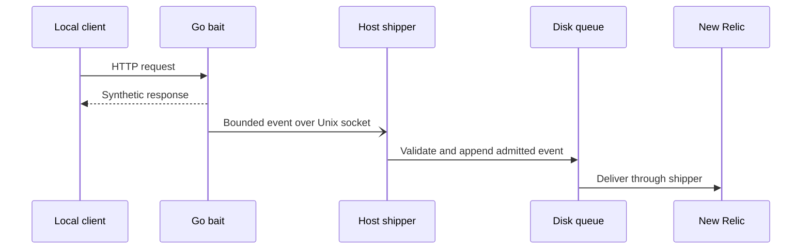

# AttackBox agent guide

## Goal and boundaries

AttackBox records evidence from simulated AI APIs for defensive research. It is a Go honeypot, not an inference service or a tool runner. Responses must stay synthetic. Do not execute captured commands, open extracted destinations, or send captured text to tools or models.

Keep local tests on loopback. Use synthetic payloads and disable remote telemetry. Do not change public ingress, deploy, or send live telemetry without explicit approval.

## Components

| Path | Responsibility |
|---|---|
| [`cmd/attackbox`](cmd/attackbox) | Configure the listeners, telemetry sink, and shutdown sequence. |
| [`internal/server`](internal/server), [`internal/responder`](internal/responder) | Serve the API personas and select synthetic responses. |
| [`internal/secret`](internal/secret), [`internal/telemetry`](internal/telemetry) | Scrub sensitive fields, bound local event transport, and format telemetry. |
| [`cmd/attackbox-shipper`](cmd/attackbox-shipper), [`internal/shipper`](internal/shipper) | Admit role-specific records, persist the queue, and deliver telemetry. The shipper binary also provides the host stdin adapters. |
| [`compose.yaml`](compose.yaml), [`deploy/`](deploy/) | Define the container profile and Ubuntu host services and controls. |
| [`site/`](site/) | Build the static docs with Nextra, Next.js, React, and pnpm. No runtime service imports the site. |



The diagram shows separate paths, not a timing guarantee. Preserve the bait and shipper separation. Only the host shipper needs the ingest key in the deployed profile. Do not treat a successful socket write as confirmation of disk commit or remote receipt.

The Ubuntu profile uses nginx and Docker Compose. The gVisor override selects `runsc`. systemd runs host services, nftables applies network policy, and Falco and the kernel journal provide host observations.

## Development setup

Use Go 1.26 or later. From the repository root, run the applicable Go and shell checks:

```bash
go vet ./...
go test -race ./...
shellcheck -S error scripts/*.sh
```

Use the [local setup in the README](README.md#local-setup) for an HTTP check. Read the [architecture guide](docs/architecture.md) before changing record or trust boundaries. Read the [operator guide](docs/operator.md) before changing runtime configuration.

For docs changes, use Node.js 22 or later and pnpm 10. From `site/`, run `pnpm install --frozen-lockfile`, `pnpm build`, and `pnpm dev --hostname 127.0.0.1`. Request every content route. After a diagram change, open it in a browser and check the zoom dialog. Keep captured payloads, internal tracker references, and deployment state out of public content.
