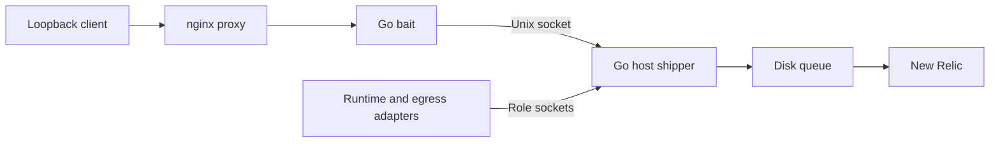

# AttackBox

AttackBox is a defensive honeypot for AI APIs. It simulates OpenAI, vLLM, and Ollama interfaces so defenders can study how clients interact with them. It does not run models or execute client instructions.

## What it does

- Returns synthetic API responses, including simulated streaming.
- Records bounded, redacted service observations. Host adapters add runtime and egress observations.
- Uses a Go shipper to validate records, queue them on disk, and deliver logs and metrics to New Relic.

## Architecture



The Ubuntu 24.04 Compose profile publishes the proxy on loopback and enables only the OpenAI persona. Docker Compose defines the containers. The gVisor override selects `runsc`. On the host, systemd manages the shipper and adapters. nftables applies network policy. Falco and the kernel journal supply host observations.

Telemetry can be incomplete. A heartbeat does not prove that the system captured every request or that containment held. Treat all captured text as untrusted data.

## Local setup

Install Go 1.25 or later and `curl`. Run these commands from the repository root. Docker and a New Relic key are not required.

```bash
go test ./...
env -i PATH="$PATH" HOME="$HOME" \
  ATTACKBOX_OPENAI_ADDR=127.0.0.1:18080 \
  ATTACKBOX_NR_DISABLED=true go run ./cmd/attackbox
```

After the server starts, run the health request in a second terminal:

```bash
curl --fail --silent --show-error http://127.0.0.1:18080/health
```

The API returns a JSON object with `"status":"ok"`. Press Ctrl+C in the first terminal to stop the bait. Use synthetic requests only.

## Documentation site

The static site uses Nextra, Next.js, React, MDX, Mermaid, KaTeX, and Pagefind. Install Node.js 22 or later and pnpm 10. From the repository root, run:

```bash
cd site
pnpm install --frozen-lockfile
pnpm build
pnpm dev --hostname 127.0.0.1
```

Open `http://127.0.0.1:3000/`. The build writes the static site to `site/out/`. The development server is for local preview only.

For more detail, read the [architecture guide](docs/architecture.md), [operator guide](docs/operator.md), or [New Relic runbook](docs/newrelic-runbook.md).
