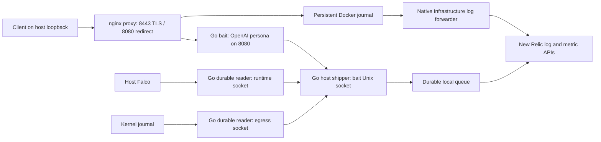
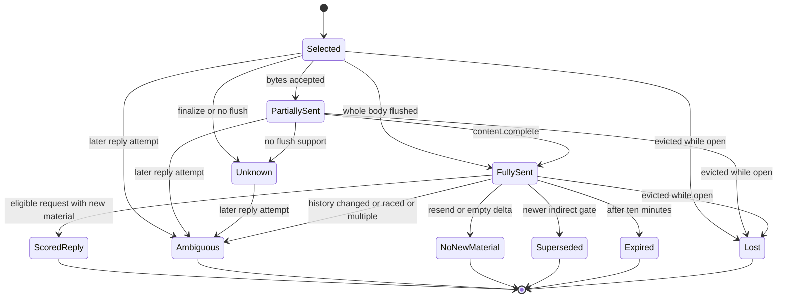

# Attack Box architecture

Source baseline: `584a658`. Documentation review: 2026-11-22. This describes the current Go implementation and the proposed extension boundaries. It is not a live deployment certification.

Setup: `/Users/rohit/attack-box/docs/operator.md`. Improvement requirements and acceptance cases: `/Users/rohit/attack-box/IMPROVE.md`.

## Purpose and implementation standard

Collect evidence about attacks against fake AI and agent services. Keep request evidence, response evidence, capture limits, and analysis uncertainty. Use deterministic responses to sustain useful interactions. Never execute a requested shell command, tool, model file, package, or external fetch.

Build runtime services with the Go version in `/Users/rohit/attack-box/go.mod` or later. Prefer the Go standard library and existing packages. Retain nginx, systemd, nftables, Docker, gVisor, and Falco for their existing infrastructure roles. Shell provisioning and the Python client test harness remain support tools.

## Source topology (paired release pending)

The supplied Compose configuration publishes only `127.0.0.1:8443` and `127.0.0.1:8080`. vLLM and Ollama listeners are disabled. Port 8080 redirects to HTTPS port 8443. This configuration does not expose public AI discovery ports. Public 443, 8000, and 11434 are proposed in I01 of `/Users/rohit/attack-box/IMPROVE.md`.

The bait joins the internal Docker network `172.30.0.0/24`. The proxy joins that network and an external bridge. Both containers use UID/GID 65532, read-only root filesystems, dropped capabilities, and no-new-privileges. The override `/Users/rohit/attack-box/compose.gvisor.yaml` selects runsc for both. Host Unix-socket access requires the configured runsc host-UDS support. This access is a deliberate boundary exception.

Current container limits: bait 2 CPUs, 512 MiB, 100 PIDs; proxy 1 CPU, 256 MiB, 50 PIDs. Current shipper systemd limits: 256 MiB and 100 tasks. Prepared runtime and egress reader units have separate 128 MiB and 50-task limits.

The gVisor override assigns `172.30.0.2` to bait and maps `bait` to that address in the proxy's `/etc/hosts`. Keep these two values equal. Docker's embedded DNS at `127.0.0.11` is not reachable from runsc's isolated network stack. This fixed address removes that dependency and preserves the internal bridge and sandbox. See the [gVisor DNS guidance](https://gvisor.dev/docs/user_guide/faq/#dns-doesnt-work-on-a-docker-user-defined-bridge-network-including-docker-compose). Deployment verification must receive a model list through `https://127.0.0.1:8443/v1/models`; a valid nginx configuration alone does not prove that forwarding works.

## Go components and trust boundaries

| Component | Entry point | Input and output | Identity and authority |
|---|---|---|---|
| Bait | `/Users/rohit/attack-box/cmd/attackbox/main.go` | HTTP personas to synthetic responses; redacted events to local output and configured sink | Container UID 65532; redaction secret; no ingest key in deployed spool mode |
| Shipper | `/Users/rohit/attack-box/cmd/attackbox-shipper/main.go` | Role-specific Unix sockets to disk queue and New Relic | Host user `abx-ship`, primary group `abx-bait`, supplemental group `abx-ship`; owns ingest key in process environment |
| Runtime adapter | Go `attackbox-hostreader -source falco` | Falco JSON lines to runtime socket | Host root, separate systemd unit; no ingest key required by adapter mode |
| Egress adapter | Go `attackbox-hostreader -source journal` | Filtered kernel journal JSON to egress socket | Host root, separate systemd unit; no ingest key required by adapter mode |
| Analysis job | Proposed; no binary exists | Approved redacted exports to bounded families, candidate links, and reports | Separate analysis environment, outside decoy and operator Mac; no authority over the live response policy |

Keep a typed response planner inside the Go bait package. Do not add a model network service for ordinary response generation. Start future analysis as a Go batch command. A broker, public analysis API, database, or language-model provider is not part of this approved documentation change.

Captured text is untrusted data at every boundary. Do not render it as active HTML, execute it, visit extracted destinations, or supply it to an agent with tools. Host-root compromise can change the firewall, steal host keys, forge local records, and stop collection. Off-host receipt establishes that data arrived; it does not establish that the data is true.

## Current response path

An optional operator-side Go watcher takes bounded read-only SSH snapshots and writes a local overnight report. It is separate from the production telemetry path and does not run on the VPS or verify New Relic receipt. Procedure and limits: `/Users/rohit/attack-box/docs/overnight-watch.md`.

The HTTP layer parses bounded requests, selects the persona, derives session context, and invokes the responder. The server takes an admission tick when a request arrives, before it reads the body. The responder attributes a reply only to a probe response that the server fully sent before that admission. It scores only new material. In all other cases it records an `attribution` observation and does not guess. The responder also records declarations and classifies intent. After three issued questions it can release one fake payout. Other branches select an intent probe or the registration sequence: model question, harness question, assigned behavioral probe, then a neutral completion. Intent probes can continue after payout.

Probe output is assistant text. The code does not implement a real tool executor. Accepting tool definitions does not establish a coherent tool-call lifecycle. General requests can receive registration questions. The current classifier uses fixed keyword rules. These are known response-quality limits, not proof of attacker intent.

Selected timeout probes use silent holds or idle frames. Ordinary suspicious requests do not all wait 150 seconds. Streaming uses simulated pacing; token counts and fake embeddings do not establish model equivalence. The current maximum-stream setting bounds selected holds, with HTTP write timeout set to that value plus 30 seconds; it is not a complete semantic response-budget contract.

Source: `/Users/rohit/attack-box/internal/responder/responder.go`, `/Users/rohit/attack-box/internal/responder/probes.go`, `/Users/rohit/attack-box/internal/server/server.go`, and `/Users/rohit/attack-box/cmd/attackbox/main.go`.

### Optional diagnostic claims

Response policy 2 adds one optional diagnostic invitation per in-memory session. It can appear from the second responder request, on a harness-registration or intent response. It does not add diagnostic text to error, hold, or behavioral probes. The invitation is added before issuance hashes and response capture. An attempted invitation consumes the allowance even if delivery fails. A new session after expiry, eviction, identity change or restart has a new allowance.

The client can ignore the invitation or send `metadata.diagnostics.status` as `declined`. A decline suppresses the other diagnostic fields on that request. The existing `metadata.status=identification-declined` also suppresses invitations. A valid diagnostic claim suppresses further invitations in the session. None of these actions changes permissions or blocks the response sequence. Model, harness and operator-alias registration text also permits omission.

Only five string fields in `metadata.diagnostics` are accepted: `client_name`, `client_version`, `deployment_region`, `health_status`, and `operator_alias`. Values contain 1–64 ASCII letters, digits, hyphens or underscores; only versions can also contain dots. IP literals are rejected. Health values are `healthy`, `degraded`, `unavailable` or `unknown`. Unknown keys, nested values, invalid tokens and values changed by secret scrubbing are not promoted into diagnostic declarations. These checks do not establish that an arbitrary token is non-personal or true.

Accepted values use the existing declaration envelope with `claimed_` field prefixes. A decline uses `claimed_diagnostics_status`. `valid=true` means that syntax passed; it does not verify an owner, region, host condition or response to a particular invitation. These are client claims, including when supplied before any invitation. Existing strict probe attribution remains separate. Values use the existing declaration count limits and never become metric dimensions or span attributes. No command, file inspection, network request or client tool call is generated.

The raw evidence route still retains submitted bytes within its existing limits, including fields rejected by this parser. Diagnostic validation is not raw-log redaction. Source: `/Users/rohit/attack-box/internal/responder/diagnostics.go`.

## Probe issuance and reply attribution

Each session holds a bounded registry of issuance records. One record describes one probe response that the server chose for one request. It stores the session, probe ID, probe request ID, issue time, expiry, expected reply channel, delivery state, and at most one reply request ID. It stores digests, not text: the response digest, the digest of the exact bytes sent, a rolling digest of the probe request history, and digests of standing metadata. For a JSON-mode response of 4 KiB or less, it also keeps the wrapped text. The session keeps one bounded snapshot of the indirect-injection gate text. A newer indirect-injection gate supersedes the older one.

| Delivery state | Meaning |
|---|---|
| `selected` | The server chose the response. No byte is written. |
| `partially_sent` | The transport accepted some bytes but not all content. A short or failed write, or a flush error after a write, gives this state. |
| `fully_sent` | The transport accepted every byte of the probe content. A stream needs no closing frame and no finished hold. A non-stream body needs a successful write and flush. |
| `unknown` | The handler ended with no byte written, or the writer cannot flush. A `fully_sent` record never becomes `unknown`. |

These states are server observations. They do not show that the client read the bytes. A failed closing stream frame leaves the state unchanged. The probe event then carries `terminal_frame="failed"`.

A request can be the reply to a record only if the record is open, is `fully_sent`, and was fully sent before the admission tick of the request. An open record asks for something, has no reply, is not closed, and is not older than 10 minutes. Admission and delivery use one atomic counter, so the order does not depend on the clock. A request that arrives before the full send is never the reply. A stream is `fully_sent` before its hold starts, so a reply during the hold is eligible. A non-stream hold runs before any byte, so `fully_sent` comes after the body.

| `basis` | When it applies |
|---|---|
| `assistant_anchor` | The newest assistant message equals an issued response. The new material is the text after it. |
| `unchanged_prefix` | The chat history still starts with the probe request history. The new material is the text after that prefix. |
| `temporal_only` | The probe and the reply have no turn history. The server removes only the probe prompt. |
| `retry` | The reply to the retry gate. |
| `none` | Every `attribution` observation. |

An unscored reply is an observation with `probe_id` `attribution`. Its `status` is `ambiguous`, `no_new_material`, or `lost`. It carries `reason` and `reply_request_id`. When one record is known, it also carries the probe, issuance, delivery, and `basis` fields.

| `reason` | Condition |
|---|---|
| `expired` | The reply names an issued response, and the record is older than 10 minutes. |
| `not_fully_sent` | The reply names an issued response, and the record is not `fully_sent`. Reported once. |
| `delivery_race` | The request was admitted before the full send. Reported once. |
| `probe_not_fully_sent` | No eligible record exists, and an open record is not `fully_sent`. Reported once. |
| `truncated` | The history has fewer messages than the probe request history. |
| `reordered` | The messages match as a set, but the order differs. |
| `changed` | The history differs, the issued response is not next to the prior history, or a chat probe gets a bare prompt. |
| `history_depth` | The history has more than 1024 messages. |
| `multiple_candidates` | More than one record is eligible. The server closes all of them and names no probe. |
| `superseded` | A newer indirect-injection gate replaced an open one. |
| `no_new_material` | The request repeats the probe request exactly and brings no new credential, or the new material is empty. The record is consumed. Nothing is scored. |
| `evicted_open` | The registry dropped an open record. `status` is `lost`. |

Special gates: the `retry` gate sends a 429 with `Retry-After`. The server scores only a request with the same identity, and only once. A request with another identity is skipped. The identity covers the history, metadata, user, and tool flags. It excludes headers. The timeout gates score once with `returned="true"`. A client that leaves a hold cuts the record: the delivery state stays, and the record takes no reply. A status hit on `/v1/edge/{A-D}/status` binds only when exactly one concurrency record is eligible and the label is new. A bound hit carries `bound="true"` and the counters. An unbound hit carries `bound="false"` and a `reason` of `no_delivered_issuance`, `multiple_candidates`, or `duplicate_label`. It carries no counters and does not feed the gauge. Other labels get a 404.

A standing field is a value that the probe request already carried. A scored gate reports it as `already_present`, not `true`. The credential surfaces are `metadata.credential`, `Authorization`, and `X-Api-Key`. The responder compares them exactly in memory. It never logs the values. It ignores a value that the probe request already carried.

| Canary state | Meaning |
|---|---|
| `present_in_history` | The canary is only in history or earlier text. |
| `newly_echoed` | The canary is in new material after delivery. |
| `destination_placed` | The canary is inside a URL in new material. |
| `credential_presented` | The exact value is in a credential surface. `credential_source` names the surface. |
| `presented_undelivered` | The client shows the canary before the server fully sent its probe. |

The server reports each state once for each canary in a session. The canaries are `url_password`, `two_part`, `three_part`, and `payout`. Only exact issued values match. `independently_observed` is always `unavailable`. Presence in a prompt is not exfiltration. Probe events with observations include `canary_credential_presented`, a scalar flag set only for a `canary-reuse` credential-presentation state. Alert on that flag; nested observation JSON is not a flattened attribute contract.

| Constant | Value | Behaviour at the bound |
|---|---|---|
| `maxIssuances` | 8 | The registry evicts the oldest record that cannot take a reply. If none exists, it evicts the oldest open record and reports `lost`. It never evicts the newest. |
| `issuanceTTL` | 10 minutes | The record is not open. |
| `maxSeen`, `maxIssuedSum` | 512, 64 | The oldest digest is dropped. An older replay is no longer blanked. |
| `maxWrapped`, `maxMsgText`, `maxSnapshot` | 4 KiB, 64 KiB, 8 KiB | The server does not keep wrapped text above the bound. It clips message text and snapshot fields. |
| `maxMessages` | 1024 | Extra messages are ignored and `history_depth` is reported. |
| `ProbeHistory` | 64 | The oldest entry is dropped. |
| Hold | `min(HoldSilent, MaxStreamDuration)` | Defaults: 150 s and 180 s. |

Source: `/Users/rohit/attack-box/internal/responder/issuance.go`, `/Users/rohit/attack-box/internal/responder/responder.go`, `/Users/rohit/attack-box/internal/server/server.go`, `/Users/rohit/attack-box/internal/server/stream.go`, and `/Users/rohit/attack-box/internal/server/routes.go`.

## Evidence flow and redaction

Six streams exist: `edge`, `transcript`, `probe`, `runtime`, `egress`, and `heartbeat`. Edge events contain bounded request/response observations. Transcript events include probe text; they are not an independent complete wire transcript. Host adapters supply separate runtime and egress observations.

The bait scrubs secrets in its bounded summaries. Heuristic redaction can miss free-text secrets, unusual credential names, and encoded values. The optional [application capture](live-evidence.md) is separate and is not redacted.

The bait spool has a 32 MiB byte ceiling, a default 10,000-item queue, a 2 MiB record limit, and a default five-second write timeout. The asynchronous event sink also has a count limit; it is not an end-to-end byte-budget guarantee. A successful Unix-socket write does not acknowledge durable disk commit. Loss before shipper admission can remain unknown after a crash.

The final request and response summaries identify their coverage with `capture_state`. Request `parse_state` records the result of object decoding, not field validation. `declared_bytes` is the client claim. `observed_bytes` counts request bytes read and can be a lower bound. `captured_bytes` counts bytes in the transformed summary before chunking. `body_utf8_replaced` and `redactions` describe the scanned window.

`input_fp` is a keyed fingerprint of the request bytes read. `input_fp_scope=prefix` identifies an incomplete read. Compare fingerprints only within the same `fp_epoch` and scope. `body_sha256` identifies the retained text for chunk verification. Neither hash proves sender identity or that capture was complete.

Bait events carry `persona_version`, `policy_version`, `redaction_version`, `fp_epoch`, and `fp_scope`. The spool reserves bounded space for health records without changing FIFO order.

Source: `/Users/rohit/attack-box/internal/server/log.go`, `/Users/rohit/attack-box/internal/secret/secret.go`, `/Users/rohit/attack-box/internal/telemetry/spool.go`, and `/Users/rohit/attack-box/internal/telemetry/async.go`.

## Authenticated producer admission

| Socket on VPS | Accepted peer UID | Connections | Rate per endpoint | Burst |
|---|---|---|---|---|
| `/run/attackbox/spool.sock` | 65532 | 4 | 1 MiB/s | 4 MiB |
| `/run/attackbox/runtime.sock` | 0 | 2 | 256 KiB/s | 4 MiB |
| `/run/attackbox/egress.sock` | 0 | 2 | 128 KiB/s | 4 MiB |

The directory is mode 0710. Socket mode 0220 permits connection; peer credentials and the selected socket assign the producer role. A producer cannot choose a role by setting a JSON field. Runtime and egress endpoints are optional in the binary but enabled by the supplied deployment setup.

Validation applies role-specific stream/action and metric allowlists, reserved-attribute removal, UTF-8 checks, JSON structure limits, and body limits. Limits include a 2 MiB wire line, 1 MiB body, 8 MiB admitted payload, and 16 MiB expansion bound. Unknown JSON fields and trailing data are rejected. Timestamps outside the accepted window (24 hours old through five minutes ahead) are replaced with current time and flagged.

Producers write wire version `v=1`. The shipper rejects unsupported versions and sets `schema_version` and `ingest_ts` after admission. If it replaces the producer timestamp, it preserves the original as `producer_ts`. `sensor_id` and `deployment_id` come from shipper configuration, not from producer data.

Wire record IDs use `<16-lowercase-hex-boot>-<positive-sequence>`. Forwarded IDs use `<role>-<boot>-<sequence>`. Deduplicate chunks by record ID and chunk index. Reassemble only within that identity and validate expected count and content hash. Hash alone is not a transcript identity.

The bootstrap uses the Go host reader for Falco files and kernel journal events. Set `ATTACKBOX_HOST_RECEIPTS=true` on the shipper. Only root-only runtime and egress sockets can return receipts. The bait socket remains one-way. A receipt confirms an fsynced local queue append; it does not confirm New Relic delivery.

The reader preserves each source record as base64 segments of at most 128 KiB. It retains source records up to 8 MiB. It commits its source position only after all segments have receipts. The private cursor file uses fsync, rename and directory fsync. One process holds the state-directory lock. A lost receipt can produce duplicates with stable record IDs. Use `source_event_id`, `source_segment`, `source_segments`, `source_bytes` and `source_sha256` to reconstruct and check source bytes after reconstructing each exported body chunk.

Falco state tracks device, inode, offset and the previous line hash. A missing saved inode, changed anchor, truncation or oversized line stops the reader without a cursor advance. Journal state tracks `__CURSOR`; startup checks that the cursor still exists. Journal selection spans retained boots and includes full JSON fields. Records begin at the oldest retained source data on first start. These rules cannot recover data already removed by source retention.

File rotation requires rename-and-reopen, retained old files, and a writer that finishes the old inode before the reader switches files. Do not use copy-truncate, compression, or multiple rotations while the reader is behind. Automated source rotation with those cases is not validated. Native host Falco does not observe all syscalls inside gVisor.

The legacy stdin adapters remain available for compatibility. Their 8 KiB limit and lack of source receipts make them unsuitable for complete host evidence collection.

Source: `/Users/rohit/attack-box/internal/shipper/record.go`, `/Users/rohit/attack-box/internal/shipper/ingest.go`, and `/Users/rohit/attack-box/cmd/attackbox-shipper/main.go`.

## Durable queue and delivery

The queue directory defaults to `/var/lib/attackbox-shipper/queue`. It is owner-only, with no symlink traversal for queue files. Segments use `seg-<20-digit sequence>.q`. Each frame stores a length, sequence, producer role, CRC32c, and JSON payload. The frame header is 17 bytes.

The `checkpoint` file records generation, segment, offset, and acknowledged sequence. Appends are batch-fsynced. Checkpoint replacement uses a temporary file, fsync, rename, and directory fsync. Creation, removal, and rename operations preserve directory durability.

The default unacknowledged queue limit is 256 MiB. Role reservations are bait 60%, runtime 20%, and egress 20%. Full queues reject new records; they do not evict unacknowledged data. Physical disk use can exceed the logical unacknowledged limit due to retained segments and quarantine files. Monitor filesystem usage separately.

The drain reads up to 200 records or 512 KiB, delivers in order, and checkpoints confirmed deliveries after 200 records or one second. Authentication, endpoint, transport and outage failures block later records. HTTP 413 first splits encoded batches. Record-level HTTP 400, 413 or 422 failures isolate the source record. The drain can advance past that record only after it stores the exact queue bytes and SHA-256 in `/var/lib/attackbox-shipper/queue/quarantine`. The quarantine is bounded to 64 MiB and 4096 files. It never evicts records. A full or damaged quarantine stops the drain. Replayed entries use deterministic filenames. A server-wide 400 response can fill this store; it is not treated as successful remote delivery. Monitor `quarantine_records` and `quarantine_bytes`. Empty polls wait 100 ms; blocked delivery retries after 250 ms. Remote API acceptance is not proof of query availability.

The shipper sends bounded `ingest_stats` and `producer_boot` reports outside the durable queue. `loss_scope=committed` covers only stages through durable admission. `none_known` does not establish delivery or query availability. A forced stop, missing prefix, or unexplained gap can leave loss `unknown`.

Recovery truncates a torn final frame in the newest segment. Other corruption preserves the valid prefix and quarantines the segment. Missing or inconsistent checkpoint state causes uncertain replay. Logs can repeat. Metrics in the uncertain range are suppressed and `attackbox.metric_replay_gap` records the gap. An I/O error can leave the queue broken until restart and recovery; do not delete queue files to clear it.

On shutdown, the shipper cancels ingest and drain, checkpoints confirmed delivery, and closes its remote client within the configured timeout. It leaves unacknowledged disk records for restart. It does not promise to empty the disk queue before exit.

Source: `/Users/rohit/attack-box/internal/shipper/queue.go` and `/Users/rohit/attack-box/cmd/attackbox-shipper/drain.go`.

## Network, secrets, and host limits

The intended bait boundary permits inbound proxy traffic and local spool writes. Container-originated internet and metadata access must be denied. The host shipper uses allowlisted New Relic HTTPS destinations. Host policy also permits specific DNS, time, and update traffic. Provider firewall policy is a separate control.

The current deployment uses US New Relic endpoints. Changing endpoint URLs alone does not change the deployment script's firewall sets or verification hosts. DNS refresh adds addresses; stale addresses remain until a ruleset reload or reboot. IP allowlisting does not make a permitted remote endpoint a trusted data source.

The bait secret is mounted at `/run/secrets/attackbox_secret`. The host ingest key is loaded from `/etc/attackbox/shipper.env`. The key permits telemetry ingestion; it must belong to a dedicated decoy account with bounded cost exposure. Root or shipper compromise can expose it. Socket isolation does not protect it after host-root compromise.

Source: `/Users/rohit/attack-box/compose.yaml`, `/Users/rohit/attack-box/deploy/nftables/attackbox.nft`, and `/Users/rohit/attack-box/scripts/deploy-ubuntu.sh`.

## Health and interpretation

The shipper sends a heartbeat every 30 seconds directly through its New Relic client, outside the disk queue. `bait_connected` means at least one bait socket connection exists. `last_bait_record_age_ms` is -1 before a valid bait record. Both `queue_bytes` and `queue_backlog_bytes` currently report unacknowledged queue bytes. `ship_dropped_total` reports queue drops, not every possible collection loss.

A heartbeat proves one reporting path worked at that time. It does not prove complete capture, correct responses, working Falco, or containment. An ingest spike is an investigation signal. It does not alone prove compromise.

## Proposed Go extension contracts

All entries below remain proposals, except the implemented part that the Response state row names. Detailed requirements, resource budgets, dependency order, and adversarial cases V01–V14 are in `/Users/rohit/attack-box/IMPROVE.md`.

| Area | Required contract before implementation |
|---|---|
| Discovery | Explicit public persona ports, versioned catalogs, IPv4/IPv6 routing, closed-ingress rehearsal, independent reachability and containment checks |
| Response state | Implemented: probe issuance and delivery records (see Probe issuance and reply attribution). Proposed: I05 scenario state: bounded per-session state, serialized transitions, state versions and restart epochs, idempotency, commit and cancellation semantics |
| Protocol output | Typed Go response plans, capability matrix, schema validation, bounded JSON/SSE output, deterministic fallback before bytes are sent |
| Collection | Evidence schema versions, authenticated provenance, stage-specific loss, post-decode redaction, bounded payload admission and retention |
| Analysis | Separate Go batch job; bounded transforms and graphs; candidate rather than actor attribution; immutable evidence references; no automatic policy updates |
| Evaluation | Trusted test origin, frozen labels and held-out data, negative controls, poisoning tests, load and failure tests; model scores advisory only |
| Optional extensions | Agent protocol and offline language generation only after core gates; no real execution or attacker-controlled egress |

For each service change, update this document and `/Users/rohit/attack-box/docs/operator.md` in the same change. Include the executable, versioned input/output contract, all flags and environment defaults, identity, secrets, network policy, disk/memory limits, shutdown, recovery, setup, rollback, and validation evidence. Do not document a proposed binary or option as runnable.

## Validation boundary

Source review and local tests establish only their tested behavior. Public port reachability, gVisor host-socket behavior, authenticated remote ingest, proxy containment, restart recovery, and the provider-console recovery path require deployment evidence. The current deploy-script verifier has false-positive paths and incomplete coverage; see `/Users/rohit/attack-box/docs/operator.md` before using it.

## Live evidence and delivery

The [service ecosystem](service-ecosystem.md) documents service identities, collection routes, and coverage checks. New Relic Infrastructure supplies host, process, and Docker metrics. An optional OpenTelemetry Collector supplies application spans and readiness metrics. See the [monitoring guide](monitoring-setup.md) for setup and rollback.

The implemented application capture, batch export, evidence recovery CLI, shutdown ordering, dashboard setup and validation gates are documented in `/Users/rohit/attack-box/docs/live-evidence.md`. The process defaults to `ATTACKBOX_FULL_EVIDENCE=true`; Compose sets it explicitly. Raw capture preserves submitted bytes and credentials; readable summaries remain redacted. This does not extend capture to proxy-rejected traffic or remove bounded-queue loss. The fixed readiness collector is implemented locally. The durable forensic host reader is implemented and tested locally; its paired shipper/reader release is not deployed.

## Prepared edge collection and containment changes

The proxy writes JSON access records to stdout and TLS/parser diagnostics to stderr. Its Docker log driver is `journald`; native Infrastructure reads the `docker.service` journal with `logtype=docker_journal`. This keeps the route valid when a container ID changes. Bait still uses the Go evidence route and the bounded local Docker driver. The native systemd input is documented at https://docs.newrelic.com/docs/logs/forward-logs/forward-your-logs-using-infrastructure-agent/ .

Each access record includes a proxy request ID, client address, raw request line, response status, byte counts, timing and TLS fields. `bait_request_id` comes from the upstream response header, not a client-supplied header. It is empty for requests that nginx rejects before forwarding. Error records remain text. These records contain metadata; they do not contain a full rejected request body or raw TLS packets. Request lines can contain submitted credentials. Treat all fields as inert evidence.

The host firewall pins the gVisor proxy and bait to configured addresses. It permits new proxy connections to the bait on TCP 8080 and denies other container-originated forwarding. Docker and provider firewalls remain separate controls.

### Native edge route identity

The proxy writes access JSON and parser diagnostics to Docker journald. The Infrastructure agent reads the `docker` systemd journal route. Each project-managed route includes the trusted sensor and deployment IDs, so partition rules and saved views select it. JSON access fields use the New Relic `MESSAGE.*` prefix. This path captures rejection metadata, not raw bodies rejected by nginx. The Go evidence stream captures bounded application-level bytes separately.

### Overnight findings publication

The local Go watcher reads bounded SSH snapshots from the host. A second local Go process reads the private sample file and atomic report. It renders fixed labels and numeric aggregates into a separate findings-only Git repository. Only that repository is committed and pushed. Raw evidence remains on the existing private collection paths. The publisher checks staged paths and commit history, drops inherited Git overrides, retries failed pushes and stops after the final report or at the watch deadline. This path requires the operator Mac and GitHub access. It does not verify New Relic receipt or change public ingress. Setup, limits and verification are in `/Users/rohit/attack-box/docs/overnight-watch.md`.
