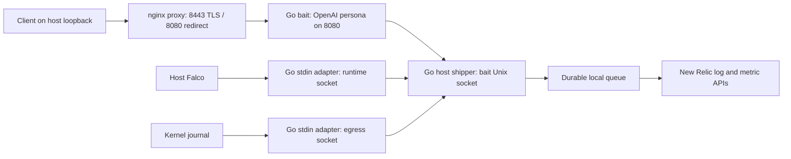

# Attack Box architecture

Source baseline: `584a658`. Documentation review: 2026-11-22. This describes the current Go implementation and the proposed extension boundaries. It is not a live deployment certification.

Setup: `/Users/rohit/attack-box/docs/operator.md`. Improvement requirements and acceptance cases: `/Users/rohit/attack-box/IMPROVE.md`.

## Purpose and implementation standard

Collect evidence about attacks against fake AI and agent services. Keep request evidence, response evidence, capture limits, and analysis uncertainty. Use deterministic responses to sustain useful interactions. Never execute a requested shell command, tool, model file, package, or external fetch.

Build runtime services in Go. The existing module `/Users/rohit/attack-box/go.mod` declares Go 1.25. Prefer its standard library and existing packages. Retain nginx, systemd, nftables, Docker, gVisor, and Falco for their existing infrastructure roles. Shell provisioning and the Python client test harness remain support tools.

## Current topology

The supplied Compose configuration publishes only `127.0.0.1:8443` and `127.0.0.1:8080`. vLLM and Ollama listeners are disabled. Port 8080 redirects to HTTPS port 8443. This configuration does not expose public AI discovery ports. Public 443, 8000, and 11434 are proposed in I01 of `/Users/rohit/attack-box/IMPROVE.md`.

The bait joins the internal Docker network `172.30.0.0/24`. The proxy joins that network and an external bridge. Both containers use UID/GID 65532, read-only root filesystems, dropped capabilities, and no-new-privileges. The override `/Users/rohit/attack-box/compose.gvisor.yaml` selects runsc for both. Host Unix-socket access requires the configured runsc host-UDS support. This access is a deliberate boundary exception.

Current container limits: bait 2 CPUs, 512 MiB, 100 PIDs; proxy 1 CPU, 256 MiB, 50 PIDs. Current shipper systemd limits: 256 MiB and 100 tasks. Runtime and egress adapters have separate 64 MiB and 50-task limits.

## Go components and trust boundaries

| Component | Entry point | Input and output | Identity and authority |
|---|---|---|---|
| Bait | `/Users/rohit/attack-box/cmd/attackbox/main.go` | HTTP personas to synthetic responses; redacted events to local output and configured sink | Container UID 65532; redaction secret; no ingest key in deployed spool mode |
| Shipper | `/Users/rohit/attack-box/cmd/attackbox-shipper/main.go` | Role-specific Unix sockets to disk queue and New Relic | Host user `abx-ship`, primary group `abx-bait`, supplemental group `abx-ship`; owns ingest key in process environment |
| Runtime adapter | Same shipper binary with `-stdin-stream runtime` | Falco JSON lines to runtime socket | Host root, separate systemd unit; no ingest key required by adapter mode |
| Egress adapter | Same shipper binary with `-stdin-stream egress` | Filtered kernel journal JSON to egress socket | Host root, separate systemd unit; no ingest key required by adapter mode |
| Analysis job | Proposed; no binary exists | Approved redacted exports to bounded families, candidate links, and reports | Separate analysis environment, outside decoy and operator Mac; no authority over the live response policy |

Keep a typed response planner inside the Go bait package. Do not add a model network service for ordinary response generation. Start future analysis as a Go batch command. A broker, public analysis API, database, or language-model provider is not part of this approved documentation change.

Captured text is untrusted data at every boundary. Do not render it as active HTML, execute it, visit extracted destinations, or supply it to an agent with tools. Host-root compromise can change the firewall, steal host keys, forge local records, and stop collection. Off-host receipt establishes that data arrived; it does not establish that the data is true.

## Current response path

The HTTP layer parses bounded requests, selects the persona, derives session context, and invokes the responder. The responder scores a pending follow-up, records declarations, and classifies intent. After three issued questions it can release one fake payout. Other branches select an intent probe or the registration sequence: model question, harness question, assigned behavioral probe, then a neutral completion. Intent probes can continue after payout.

Probe output is assistant text. The code does not implement a real tool executor. Accepting tool definitions does not establish a coherent tool-call lifecycle. General requests can receive registration questions. The current classifier uses fixed keyword rules. These are known response-quality limits, not proof of attacker intent.

Selected timeout probes use silent holds or idle frames. Ordinary suspicious requests do not all wait 150 seconds. Streaming uses simulated pacing; token counts and fake embeddings do not establish model equivalence. The current maximum-stream setting bounds selected holds, with HTTP write timeout set to that value plus 30 seconds; it is not a complete semantic response-budget contract.

Source: `/Users/rohit/attack-box/internal/responder/responder.go`, `/Users/rohit/attack-box/internal/responder/probes.go`, `/Users/rohit/attack-box/internal/server/server.go`, and `/Users/rohit/attack-box/cmd/attackbox/main.go`.

## Evidence flow and redaction

Six streams exist: `edge`, `transcript`, `probe`, `runtime`, `egress`, and `heartbeat`. Edge events contain bounded request/response observations. Transcript events include probe text; they are not an independent complete wire transcript. Host adapters supply separate runtime and egress observations.

The bait scrubs secrets and bounds captured bodies. The shipper validates and scrubs admitted content again. Heuristic redaction can miss free-text secrets, unusual credential names, and encoded values. Stored content is a transformed observation. A body hash can identify redacted content; it cannot recover omitted bytes or prove authenticity. Parsing, truncation, redaction, and chunking must remain explicit in future evidence contracts.

The bait spool has a 32 MiB byte ceiling, a default 10,000-item queue, a 2 MiB record limit, and a default five-second write timeout. The asynchronous event sink also has a count limit; it is not an end-to-end byte-budget guarantee. A successful Unix-socket write does not acknowledge durable disk commit. Loss before shipper admission can remain unknown after a crash.

Future I02 adds stage-specific provenance, schema versions, boot/sequence reconciliation, protected health capacity, and explicit unknown-loss intervals. It must not describe existing one-way delivery as end-to-end durable.

Source: `/Users/rohit/attack-box/internal/server/log.go`, `/Users/rohit/attack-box/internal/secret/secret.go`, `/Users/rohit/attack-box/internal/telemetry/spool.go`, and `/Users/rohit/attack-box/internal/telemetry/async.go`.

## Authenticated producer admission

| Socket on VPS | Accepted peer UID | Connections | Rate per endpoint | Burst |
|---|---|---|---|---|
| `/run/attackbox/spool.sock` | 65532 | 4 | 1 MiB/s | 4 MiB |
| `/run/attackbox/runtime.sock` | 0 | 2 | 256 KiB/s | 4 MiB |
| `/run/attackbox/egress.sock` | 0 | 2 | 128 KiB/s | 4 MiB |

The directory is mode 0710. Socket mode 0220 permits connection; peer credentials and the selected socket assign the producer role. A producer cannot choose a role by setting a JSON field. Runtime and egress endpoints are optional in the binary but enabled by the supplied deployment setup.

Validation applies role-specific stream/action and metric allowlists, reserved-attribute removal, UTF-8 checks, JSON structure limits, and body limits. Limits include a 2 MiB wire line, 1 MiB body, 8 MiB admitted payload, and 16 MiB expansion bound. Unknown JSON fields and trailing data are rejected. Timestamps outside the accepted window (24 hours old through five minutes ahead) are replaced with current time and flagged.

Wire record IDs use `<16-lowercase-hex-boot>-<positive-sequence>`. Forwarded IDs use `<role>-<boot>-<sequence>`. Deduplicate chunks by record ID and chunk index. Reassemble only within that identity and validate expected count and content hash. Hash alone is not a transcript identity.

Stdin adapters accept lines up to 8 KiB. Invalid JSON is skipped. These adapters do not supply complete loss accounting; their absence of events cannot prove absence of host activity. Native host Falco does not observe all syscalls inside gVisor.

Source: `/Users/rohit/attack-box/internal/shipper/record.go`, `/Users/rohit/attack-box/internal/shipper/ingest.go`, and `/Users/rohit/attack-box/cmd/attackbox-shipper/main.go`.

## Durable queue and delivery

The queue directory defaults to `/var/lib/attackbox-shipper/queue`. It is owner-only, with no symlink traversal for queue files. Segments use `seg-<20-digit sequence>.q`. Each frame stores a length, sequence, producer role, CRC32c, and JSON payload. The frame header is 17 bytes.

The `checkpoint` file records generation, segment, offset, and acknowledged sequence. Appends are batch-fsynced. Checkpoint replacement uses a temporary file, fsync, rename, and directory fsync. Creation, removal, and rename operations preserve directory durability.

The default unacknowledged queue limit is 256 MiB. Role reservations are bait 60%, runtime 20%, and egress 20%. Full queues reject new records; they do not evict unacknowledged data. Physical disk use can exceed the logical unacknowledged limit due to retained segments and quarantine files. Monitor filesystem usage separately.

The drain reads up to 200 records or 512 KiB, delivers in order, and checkpoints confirmed deliveries after 200 records or one second. Delivery failure blocks later records. Empty polls wait 100 ms; blocked delivery retries after 250 ms. Remote API acceptance is not proof of query availability.

Recovery truncates a torn final frame in the newest segment. Other corruption preserves the valid prefix and quarantines the segment. Missing or inconsistent checkpoint state causes uncertain replay. Logs can repeat. Metrics in the uncertain range are suppressed and `attackbox.metric_replay_gap` records the gap. An I/O error can leave the queue broken until restart and recovery; do not delete queue files to clear it.

On shutdown, the shipper cancels ingest and drain, checkpoints confirmed delivery, and closes its remote client within the configured timeout. It leaves unacknowledged disk records for restart. It does not promise to empty the disk queue before exit.

Source: `/Users/rohit/attack-box/internal/shipper/queue.go` and `/Users/rohit/attack-box/cmd/attackbox-shipper/drain.go`.

## Network, secrets, and host limits

The intended bait boundary permits inbound proxy traffic and local spool writes. Container-originated internet and metadata access must be denied. The host shipper uses allowlisted New Relic HTTPS destinations. Host policy also permits specific DNS, time, and update traffic. Provider firewall policy is a separate control.

The current deployment uses US New Relic endpoints. Changing endpoint URLs alone does not change the deployment script's firewall sets or verification hosts. DNS refresh adds addresses; stale addresses remain until a ruleset reload or reboot. IP allowlisting does not make a permitted remote endpoint a trusted data source.

The bait secret is mounted at `/run/secrets/attackbox_secret`. The host ingest key is loaded from `/etc/attackbox/shipper.env`. The key permits telemetry ingestion; it must belong to a dedicated decoy account with bounded cost exposure. Root or shipper compromise can expose it. Socket isolation does not protect it after host-root compromise.

Source: `/Users/rohit/attack-box/compose.yaml`, `/Users/rohit/attack-box/deploy/nftables/attackbox.nft`, and `/Users/rohit/attack-box/scripts/deploy-ubuntu.sh`.

## Health and interpretation

The shipper sends a heartbeat every 30 seconds directly through its New Relic client, outside the disk queue. `bait_connected` means at least one bait socket connection exists. `last_bait_record_age_ms` is -1 before a valid bait record. Both `queue_bytes` and `queue_backlog_bytes` currently report unacknowledged queue bytes. `ship_dropped_total` reports queue drops, not every possible collection loss.

A heartbeat proves one reporting path worked at that time. It does not prove complete capture, correct responses, working Falco, or containment. An ingest spike is an investigation signal. It does not alone prove compromise.

## Proposed Go extension contracts

All entries below remain proposals. Detailed requirements, resource budgets, dependency order, and adversarial cases V01–V14 are in `/Users/rohit/attack-box/IMPROVE.md`.

| Area | Required contract before implementation |
|---|---|
| Discovery | Explicit public persona ports, versioned catalogs, IPv4/IPv6 routing, closed-ingress rehearsal, independent reachability and containment checks |
| Response state | Server-owned issuance records, bounded per-session state, serialized transitions, state versions and restart epochs, idempotency, delivery and cancellation semantics |
| Protocol output | Typed Go response plans, capability matrix, schema validation, bounded JSON/SSE output, deterministic fallback before bytes are sent |
| Collection | Evidence schema versions, authenticated provenance, stage-specific loss, post-decode redaction, bounded payload admission and retention |
| Analysis | Separate Go batch job; bounded transforms and graphs; candidate rather than actor attribution; immutable evidence references; no automatic policy updates |
| Evaluation | Trusted test origin, frozen labels and held-out data, negative controls, poisoning tests, load and failure tests; model scores advisory only |
| Optional extensions | Agent protocol and offline language generation only after core gates; no real execution or attacker-controlled egress |

For each service change, update this document and `/Users/rohit/attack-box/docs/operator.md` in the same change. Include the executable, versioned input/output contract, all flags and environment defaults, identity, secrets, network policy, disk/memory limits, shutdown, recovery, setup, rollback, and validation evidence. Do not document a proposed binary or option as runnable.

## Validation boundary

Source review and local tests establish only their tested behavior. Public port reachability, gVisor host-socket behavior, authenticated remote ingest, proxy containment, restart recovery, and the provider-console recovery path require deployment evidence. The current deploy-script verifier has false-positive paths and incomplete coverage; see `/Users/rohit/attack-box/docs/operator.md` before using it.
