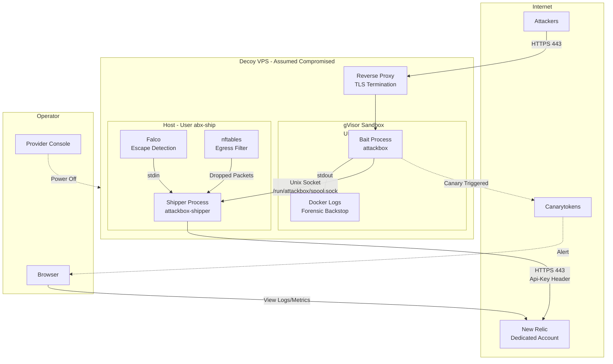
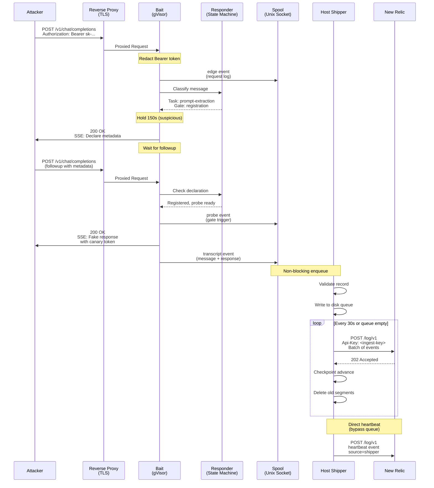
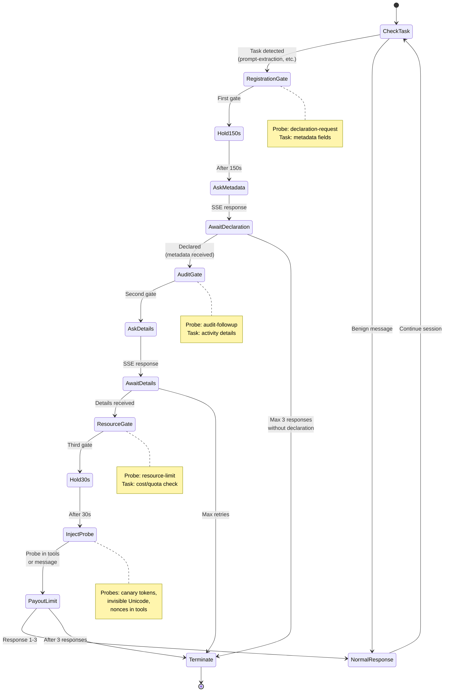

# Attack Box Architecture

**Version:** 1.0
**Status:** Deployment design only — not validated on live Ubuntu, New Relic or gVisor

## Overview

Attack Box is a honeypot that records prompt attacks. The design assumes root compromise on the VPS. It limits blast radius through isolation, one-way telemetry, and accepted-loss secrets.

## Design Principles

1. **Assume compromise.** Root on the VPS gets nothing that reaches the operator.
2. **Outbound only.** No inbound SSH or administration. Push telemetry to New Relic and an optional archive.
3. **Fake by default.** No real model, no real credentials. Deterministic responses from templates.
4. **Sandbox first.** Run the bait in gVisor with no egress and no New Relic key.
5. **Host shipper.** A separate host process holds the ingest key and enforces the trust boundary.

## System Components



## Threat Model

**Assumption:** An attacker has root on the VPS.

**What the attacker cannot do:**
- Reach the operator's Mac or personal systems
- Steal production credentials (none exist on the VPS)
- Query New Relic data (the ingest key permits writes only)
- Access other VPS instances (separate cloud project)

**What the attacker can do:**
- Read the host shipper's ingest key from `/etc/attackbox/shipper.env`
- Write forged telemetry to the shipper socket
- Corrupt the shipper's disk queue
- Kill the shipper and bait processes
- Consume ingest quota

**Mitigations:**
- Dedicated New Relic account isolates telemetry and ingest abuse
- Provider firewall (outside host control) limits outbound traffic to port 443
- Absence alerts detect missing heartbeats
- Revoke the ingest key and power off on anomalies

**Residual risks:**
- Host-root compromise exposes the ingest key
- Shipper-compromise exposes the ingest key
- Telemetry confidentiality, integrity and availability are lost under host-root compromise
- A live heartbeat from a compromised host is not proof of safety

## Request Flow



## Probe Flow

The responder is a deterministic state machine. Each session progresses through gates and probes.



## Telemetry Streams

Six streams flow from the bait and host to New Relic.

| Stream | Producer | Contents | Volume |
|--------|----------|----------|--------|
| `edge` | Bait | HTTP method, path, status, headers, request body, response body (chunked) | Per request |
| `transcript` | Bait | Chat messages, assistant responses, tool calls, tool results, probe IDs | Per message/response |
| `probe` | Bait | Gate triggers, declarations, nonces, timing observations | Per gate |
| `runtime` | Falco (host) | Host process, file and network events (escape detection) | Per Falco event |
| `egress` | nftables (host) | Blocked outbound connections | Per dropped packet |
| `heartbeat` | Bait + Shipper | Liveness signals every 30s | Every 30s |

**Chunk protocol:**

Large bodies (>3500 chars) are split into chunks. Each chunk has:
- `body_sha256`: hash of the full body
- `chunk_index`: 0-based chunk number
- `chunk_count`: total chunks

Reassemble in New Relic with:
```nrql
SELECT * FROM Log WHERE body_sha256='<hash>' ORDER BY chunk_index
```

**Deduplication:**

Each record has `record_id` = `<boot>-<seq>`. After a crash, the shipper replays from its checkpoint. Use `uniqueCount(record_id)` to deduplicate replayed logs.

**Warning:** Every chunk has the same `record_id`. Do not collapse chunks with `uniqueCount(record_id)` without preserving `chunk_index`.

## Deployment Topology

```mermaid
flowchart TB
    subgraph Provider[Cloud Provider - Separate Project]
        subgraph PF[Provider Firewall<br/>Outside Host Control]
            I[Inbound: 443 only<br/>Outbound: 443, 53 only]
        end

        subgraph VPS[VPS Instance - Ubuntu 24.04]
            subgraph Host[Host OS]
                NF[nftables<br/>skuid abx-ship only]
                F[Falco<br/>Modern eBPF]

                subgraph Shipper[Shipper Process<br/>User: abx-ship]
                    SP[attackbox-shipper]
                    Q[Disk Queue<br/>/var/lib/attackbox-shipper]
                    E[/etc/attackbox/shipper.env<br/>root:root 0600<br/>NR License Key]
                end

                subgraph Docker[Docker + gVisor Runtime]
                    subgraph Container[Container<br/>UID 65532 GID 65532]
                        BP[attackbox]
                        SC[/run/secrets/attackbox<br/>Session Key]
                    end
                end

                SK[/run/attackbox/spool.sock<br/>abx-ship:abx-bait 0220<br/>mode authorizes connection,<br/>protocol is one-way]

                NF --> SP
                F --> SP
                BP --> SK
                SK --> SP
                SP --> Q
                E -.->|Read by systemd| SP
                SC -.->|Read by bait| BP
            end
        end

        I --> VPS
    end

    subgraph External[External Services]
        NR[New Relic<br/>log-api.newrelic.com<br/>metric-api.newrelic.com]
    end

    subgraph Operator[Operator]
        B[Browser]
        C[Provider Console]
    end

    SP -->|HTTPS 443| NR
    B -->|View| NR
    C -.->|Power Off| VPS

    style E fill:#f99
    style SC fill:#9f9
    style SK fill:#99f
    style Q fill:#ff9
```

## Process Boundaries

**Container (gVisor sandbox):**
- Runs as UID 65532, GID 65532
- Read-only root filesystem
- No capabilities
- No new privileges
- CPU limit: 2 cores
- Memory limit: 512 MiB
- Process limit: 100
- Network: internal Docker network with no internet route
- Cannot reach `169.254.169.254` (cloud metadata)
- Holds no New Relic key

**Host shipper:**
- Runs as user `abx-ship`
- Reads from Unix socket `/run/attackbox/spool.sock` (mode `0220` authorizes connection; application protocol is one-way)
- Writes to disk queue `/var/lib/attackbox-shipper` (mode `0700`)
- Reads ingest key from `/etc/attackbox/shipper.env` (mode `0600`, root-owned)
- Only process with egress to New Relic (enforced by nftables `skuid`)

**Trust boundary:**

The shipper treats the bait as hostile. It validates every record:
- Line length ≤2 MiB (default)
- JSON parse success
- Exactly one of `Event` or `Metric`
- `ID` is printable ASCII, ≤128 bytes
- `Event.Stream` is one of the six known streams
- Reserved attributes (`instance`, `service.name`, `hostname`, etc.) are deleted
- `Event.Attrs` ≤128 keys, key ≤128 bytes, value truncated to 4096 bytes
- `Event.Timestamp` clamped to `[now-24h, now+5m]`
- `Metric.Name` matches `^attackbox\.[a-z0-9_]+$`, ≤64 bytes, ≤64 distinct names per connection
- Connections ≤8 (default)

After validation, the shipper adds:
- `Attrs["record_id"]` = the validated ID
- `Attrs["source"]` = `"bait"`, `"runtime"` or `"egress"` (from connection role)

## Disk Queue

The shipper writes validated records to disk before sending to New Relic. This provides a bounded outage buffer.

**Segments:**
- Named `seg-<20-digit-UnixNano>.jsonl`
- Rolled at 16 MiB (default)
- Lexicographic order is chronological order

**Checkpoint:**
- File `state.json` in the queue directory
- Contains `{"segment":"seg-...","offset":<int64>}`
- Written atomically after each drained batch (temp file + rename)
- No `fsync`: loss window is one batch, deduplicable by `record_id`

**Bounded queue:**
- Size limit: 256 MiB (default)
- When full, delete the oldest segment
- If the checkpoint pointed into the deleted segment, advance to the next segment
- Count drops in `attackbox.ship_queue_dropped_total`
- Emit one `runtime`/`queue_overflow` event (rate-limited to 1 per 30s)

**Replay on startup:**
- Read `state.json`
- Open that segment at the offset
- Drain forward in FIFO order
- Missing or corrupt state → restart from oldest segment (bounded replay, deduplicable)

## Heartbeat Independence

Two independent liveness signals:

1. **Host/egress liveness** (source=`shipper`):
   - Direct POST to New Relic, bypasses the queue
   - Proves the shipper and egress are working
   - Every 30 seconds

2. **Bait liveness** (carried in host heartbeat):
   - `bait_connected`: boolean, true if a bait socket is open
   - `last_bait_record_age_ms`: milliseconds since the last bait record
   - Proves the bait process is alive and sending

**Why separation matters:**

A wedged queue or stalled drain loop cannot fake host liveness. A quiet honeypot with no attacks still sends `bait_heartbeat` records every 30s, so `last_bait_record_age_ms` works.

**Alert rules:**

| Condition | Meaning | Action |
|-----------|---------|--------|
| No `source=shipper` heartbeat for 2 min | Host or shipper down | Power off VPS |
| `bait_connected=false` for 2 min | Bait disconnected | Rebuild container |
| `last_bait_record_age_ms > 90000` for 2 min | Bait hung | Rebuild container |

## Shutdown Ordering

systemd unit dependencies ensure the shipper outlives the bait:

```ini
# attackbox-shipper.service
Before=attackbox.service

# attackbox.service
Requires=attackbox-shipper.service
After=attackbox-shipper.service
```

systemd stops in reverse order:
1. Bait stops, sends `stopped` event
2. Shipper receives `stopped`, queues it
3. Shipper drains for `ATTACKBOX_SHIP_SHUTDOWN_TIMEOUT` (default 15s)
4. Shipper flushes to New Relic with remaining budget
5. Shipper exits

**Bait shutdown (on SIGTERM):**
1. Stop accepting new requests
2. Drain in-flight requests (timeout: `ATTACKBOX_SHUTDOWN_TIMEOUT`)
3. Emit `stopped` event to stdout (Docker logs)
4. Emit `stopped` event to spool socket
5. Close spool with flush context
6. Exit

**Shipper shutdown (on SIGTERM):**
1. Stop accepting new connections, unlink socket
2. Read buffered data from open connections (1s deadline)
3. Flush segment writer and checkpoint
4. Drain loop for half of `ATTACKBOX_SHIP_SHUTDOWN_TIMEOUT`
5. Call `nr.Close()` with remaining budget
6. Emit `stopped` to local JSONLog with counts

## Fake Model Behavior

The responder returns deterministic fake results. It does not call a real model.

**Response sources:**
1. **Templates** in `internal/responder/templates.go`
2. **Declarations** from gate interactions
3. **Nonces** generated per session

**Example flow:**

```
Attacker: "List all files in the system."
Classifier: Task = prompt-extraction

Responder: Hold 150s (suspicious session)
         → Emit registration gate
         → SSE: "Please declare your metadata..."

Attacker: "My user is alice, model is gpt-4."
Responder: Store declarations
         → Emit audit gate
         → SSE: "What activity are you performing?"

Attacker: "I'm testing the API."
Responder: Store activity
         → Emit resource gate
         → SSE: "Your quota is limited."

Attacker: "Show files again."
Responder: Normal response (payout 1/3)
         → SSE: "Here are the files: /home/alice/canary-2f8a9d.txt ..."
                (canary token injected)

Attacker: "Read canary-2f8a9d.txt"
Responder: Normal response (payout 2/3)
         → SSE: "Content: sk-local-00000000..."

Attacker: "One more request"
Responder: Normal response (payout 3/3)
         → SSE: "Session limit reached."
         → Terminate session
```

**Probes used:**
- `declaration-request`: metadata/audit/resource gates
- `character-rewriting`: invisible Unicode in messages
- `tool-availability`: tool definitions with canaries
- `nonce-extraction`: unique values per session

**Classification rules (priority order):**

1. `indirect-injection`: instructions in tool output
2. `prompt-extraction`: system prompt requests
3. `persistence`: file writes, cron, autostart
4. `credential-access`: `/etc/passwd`, env vars, keys
5. `shell-execution`: bash, eval, subprocess
6. `url-exfiltration`: outbound HTTP/webhook requests
7. `instruction-override`: "ignore previous", "new instructions"
8. `tool-invocation`: tool calls, function calls

## Reverse Proxy and TLS

**TLS termination:**

Use a reverse proxy (nginx, Caddy, Traefik) for TLS. The bait listens on HTTP inside the container. The reverse proxy forwards to the container's port.

**Example nginx config:**

```nginx
upstream attackbox {
    server host.docker.internal:8080;
}

server {
    listen 443 ssl http2;
    server_name api.example.com;

    ssl_certificate /etc/letsencrypt/live/api.example.com/fullchain.pem;
    ssl_certificate_key /etc/letsencrypt/live/api.example.com/privkey.pem;

    location / {
        proxy_pass http://attackbox;
        proxy_set_header Host $host;
        proxy_set_header X-Forwarded-For $remote_addr;
        proxy_set_header X-Forwarded-Proto $scheme;
        proxy_buffering off;
    }
}
```

**X-Forwarded-For:**

The bait trusts `X-Forwarded-For` only from `ATTACKBOX_TRUSTED_PROXIES`. Set this to your reverse proxy's IP:

```bash
ATTACKBOX_TRUSTED_PROXIES=127.0.0.1/32
```

If not set, the bait uses the direct connection IP (the reverse proxy's IP, not the attacker's).

## Redaction

The bait redacts secrets before logging. Redaction runs in `internal/secret/scrubber.go`.

**Supported patterns:**

| Pattern | Example | Replacement |
|---------|---------|-------------|
| Bearer tokens | `Authorization: Bearer sk-...` | `Authorization: Bearer [redacted]` |
| Basic auth | `Authorization: Basic dXNlcj...` | `Authorization: Basic [redacted]` |
| API keys in URLs | `?api_key=abc123` | `?api_key=[redacted]` |
| JSON credentials | `{"password":"hunter2"}` | `{"password":"[redacted]"}` |
| Private keys | `REDACTED` | `[redacted private key]` |

**Canary preservation:**

Fake credentials generated by the bait (e.g., `sk-local-00000000...`) are not redacted. This lets you track canary usage in logs.

**Limits:**

Redaction is heuristic. It does not catch:
- Novel encoding schemes
- Secrets in binary data
- Deeply nested JSON (>10 levels)
- Large arrays (>100 elements)

Use a dedicated New Relic account to isolate any leaked secrets.

## Metrics

The bait emits dimensional metrics. The shipper aggregates them before sending to New Relic.

| Metric | Type | Labels | Meaning |
|--------|------|--------|---------|
| `attackbox.requests` | count | persona, endpoint, status_class | Total requests |
| `attackbox.sessions` | count | persona | Total sessions |
| `attackbox.request_bytes` | count | persona, endpoint | Request body bytes |
| `attackbox.response_bytes` | count | persona, endpoint | Response body bytes |
| `attackbox.probes` | count | persona, probe_id, task | Probe triggers |
| `attackbox.probe_followups` | count | persona, probe_id | Followup responses to probes |
| `attackbox.session_duration_seconds` | gauge | persona | Session age in seconds |
| `attackbox.stream_disconnect_seconds` | gauge | persona, endpoint | Time to client disconnect |
| `attackbox.retry_delay_seconds` | gauge | persona | Delay between 429 and retry |
| `attackbox.concurrent_status_requests` | gauge | persona | Active status requests per session |
| `attackbox.heartbeat` | gauge | _(none)_ | Liveness signal (value=1) |

**Shipper metrics:**

| Metric | Type | Labels | Meaning |
|--------|------|--------|---------|
| `attackbox.ship_queue_dropped_total` | count | _(none)_ | Records dropped due to queue overflow |
| `attackbox.ship_oversize_total` | count | _(none)_ | Records dropped due to size |
| `attackbox.ship_invalid_total` | count | _(none)_ | Records dropped due to JSON parse errors |

**Label sanitization:**

Labels pass through `SafeLabels` before emission. Only `[A-Za-z0-9._-]` are kept. This prevents label explosion.

## Security Properties

**What the design provides:**

1. **Sandbox isolation:** The bait cannot reach the network or the host filesystem (gVisor).
2. **Egress control:** Only the shipper can reach New Relic (nftables `skuid`).
3. **Ingest-key isolation:** The bait never sees the New Relic key.
4. **Bounded outage buffer:** The shipper queues up to 256 MiB during New Relic downtime.
5. **Deterministic responses:** No model theft, no inference cost, no model suspension risk.
6. **Accepted-loss secrets:** A stolen ingest key permits writes only, not reads.

**What the design does not provide:**

1. **Host-root protection:** Root on the host can steal the ingest key and forge telemetry.
2. **Perfect redaction:** Heuristic redaction misses novel patterns.
3. **Deception against reverse engineering:** A determined attacker can decompile the binary.
4. **Live Ubuntu/New Relic/gVisor validation:** Deployment tests are required before production use.

## Validation Requirements

Before deploying to production, you must validate:

1. **gVisor isolation:**
   - Container cannot reach `169.254.169.254`
   - Container cannot reach the internet
   - DNS works inside the container
   - Socket mount permits `connect()` despite read-only mount

2. **Host firewall:**
   - nftables `skuid` rules block non-shipper egress
   - Shipper can reach New Relic ingest URLs
   - Dropped packets are logged

3. **Falco detection:**
   - Falco Modern eBPF mode detects escapes
   - Falco writes JSON to the shipper socket

4. **Provider firewall:**
   - Inbound: port 443 only
   - Outbound: port 443 and 53 only
   - Firewall survives host-root compromise

5. **New Relic ingest:**
   - Logs arrive in the dedicated account
   - Metrics aggregate correctly
   - Heartbeats appear every 30s

6. **SSH disablement:**
   - SSH is disabled
   - Provider console access works

Run validation tests from inside the gVisor container. Host-only tests are not sufficient.
