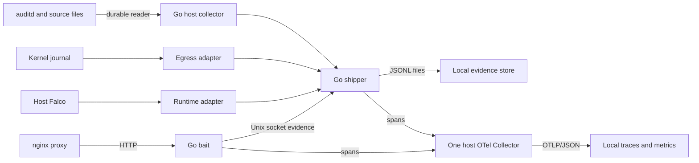

# Service ecosystem and evidence collection

## Recommended view

## Topology and collection routes

Solid arrows describe configured routes, not measured distributed traces. The durable Go reader replaced the follow-only adapters. Keep raw evidence on the Go shipper route.

## Coverage contract

| Component | Required observation | Required proof |
|---|---|---|
| VPS host | CPU, available RAM, disk, inodes, boot ID, network and collection age | Compare with OS readings; file freshness alert when collection stops |
| nginx proxy | Container health, restart count, status classes, upstream errors, TLS readiness | Loopback HTTPS request must reach bait; invalid HTTP must appear in edge evidence |
| Go bait | Separate service identity, request/hold/response spans, runtime metrics, producer loss | Known canary has correlated trace and evidence; deliberate hold appears as latency |
| Go shipper | Separate service identity, queue bytes/age, retries, last write, dropped records | A canary is in evidence files; file write alone is insufficient |
| Runtime adapter | Unit state, producer heartbeat, source read age, reader loss | Harmless marked Falco fixture in evidence files |
| Egress adapter | Unit state, producer heartbeat, source read age, reader loss | Controlled blocked-egress fixture in evidence files |
| Falco | Unit state, rule version, capture/output loss | Harmless rule fixture; host monitoring is not proof of guest syscall visibility |
| auditd | Unit state, rule-load status, backlog/lost counts, reader age | Marked audit fixture; active auditd alone does not prove collection |
| nftables | Expected rule-set identity and deny counters | Controlled denial; an active oneshot unit is not proof of containment |
| Docker/containerd/runsc | Daemon health, container identity, runtime, OOM/restarts and resource limits | Compare live container inspection to approved configuration |
| Go host collector | Cursor age, read/parse loss, rotation state and durable receipt | Restart/rotation tests preserve records or report an explicit gap |
| OTel Collector | Export failures, refused/dropped spans, queue size, resource pressure | Stop exporter in a test environment; bounded queue and separate missing-signal alert |

Display `running`, `ready`, `telemetry fresh`, and `coverage verified` separately. Use gray for missing or stale observations. A lack of attacks is not a broken sensor; an absence of sensor heartbeats is a monitoring gap.

## Instrumentation choice

Use the official OTel Go SDK for bait and shipper and one pinned Collector for application spans and metrics. Keep the Go shipper for raw evidence and its durable queue. Local tracing uses Collector 0.165.0 with file exporters for OTLP/JSON.

Use stable names such as `attackbox-bait` and `attackbox-shipper`. Add `service.instance.id`, service version and trusted campaign tags. Match `host.id` across services and host metrics; use the actual `container.id` for container relationships. Keep a common trusted sensor identifier on evidence.

The host must assign or validate infrastructure identity. A bait request cannot choose its service, host or campaign tags. Start new trusted traces at the first instrumented boundary; ignore client trace and sampling authority. Keep bodies and credentials in evidence, not spans. Preserve exact request IDs for log/trace joins. For asynchronous queue exports, use span links or separate producer/consumer spans where supported. Do not make all records in an export batch children of one attack request. Do not fabricate spans to draw a desired map.

The current pinned nginx image does not supply verified OTel instrumentation. Start with container and readiness monitoring plus edge/request correlation. Mark the proxy-to-bait edge as declared until proxy tracing is implemented and tested.

The OTel receiver must be private and restricted to approved producers. Collector endpoint changes must ship with firewall updates. The Go host evidence reader must not gain a general Docker control socket. If container details need privileged inspection, use a separate fixed host check with bounded output.

## Health and freshness

Initial proposed cadence: host/unit readiness every 15 seconds, producer heartbeat every 30 seconds, and a synthetic end-to-end request every 60 seconds. Mark observations stale after 90 seconds and missing canary delivery after three minutes. Tune thresholds against measured collection delay and campaign load. These are proposed settings, not a measured SLA.

Keep the canary path independent of attacker volume. Use a deterministic short model-list request, a unique request marker and expected evidence hashes. Mark synthetic traffic so research counts can exclude it. Validate that marking cannot let arbitrary external requests hide themselves. Compare source and collection times. Treat delayed historical telemetry as delayed, not live.

Use file freshness alerts for the shipper, collector and host. A dead collector cannot report its own death. Keep health emission independent of a congested evidence queue. Never fill a missing-health interval with zero or carry a stale healthy value indefinitely.

The implemented inventory checks ten fixed systemd units and two fixed containers. Dynamic discovery and comparison remain planned; unknown extra components are not yet detected. Missing expected components remain visible. This avoids the false result where a dead service disappears and the remaining map looks healthy.

## Acceptance and rollout

Implement host identity, inventory and readiness first. Add Go tracing and evidence correlation next. Validate service-by-service failures in a local or closed-ingress test environment. Stop each producer, break a test export route, fill a bounded test queue and restart the collector. Each test must change the correct health/coverage state without hiding unaffected evidence.

Test trace sampling gaps and file freshness behavior. Confirm a request can be followed from readiness/edge evidence to bait, queue and written evidence files using the appropriate joins. No claim of complete guest visibility or packet capture follows from this monitoring.

Go tracing and readiness collector are deployed and verified. The review surface is `/Users/rohit/attack-box/.lavish/service-ecosystem.html`.

## Evidence file structure

Evidence files use JSONL format with line-delimited JSON records. Each record includes `filePath`, `stream`, `action`, and routing fields. Query with `jq` or DuckDB for ad hoc analysis. See [monitoring guide](monitoring-setup.md) for file paths and query examples.

Use file and event fields to select records. Routing fields establish trusted source identity.

## Implemented scope and limits

The Go readiness collector reports unit state, container health and limits, snapshot age, and fixed loopback probes. It does not read audit evidence or certify delivery. All coverage verification values remain `-1` until a separate verified delivery mechanism exists. Readiness is supported only for bait, proxy, OTel and the readiness collector itself. Other readiness values are `-1`.

Bait traces use fresh roots and ignore incoming trace headers. Evidence retains `trace.id` and `span.id`. Shipper batches use independent client spans; exported copies add `export.trace.id` and `export.span.id`. The exporter does not fabricate enqueue spans. SDK export counters prove only Collector receipt, not final file write. Raw logs continue through the existing shipper.

