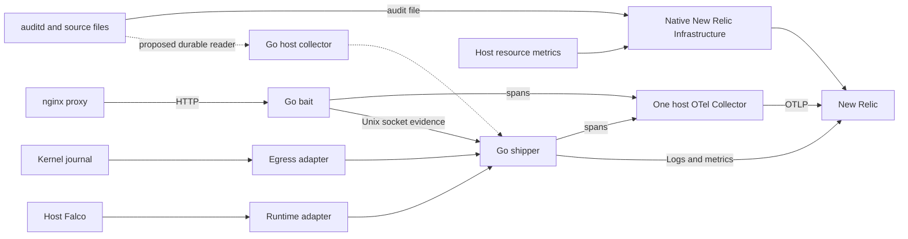

# Service ecosystem in New Relic

## Recommended view

Create one New Relic workload named `AttackBox / srv-000000`. Group the host, instrumented Go services and supported infrastructure entities with trusted campaign tags. Use native Maps for dependencies. The documented `topology.service-map` dashboard widget returns a UI 404 in this account. Use the verified direct workload Maps link in the dashboard. Put a coverage table next to it. Every expected component must remain in that table even when it sends no data.

New Relic Maps supports service, infrastructure and workload views. Traces help establish service calls; resource identities connect services to hosts and containers. Maps does not automatically turn every systemd unit or Unix socket into a service. Where New Relic has no suitable entity, retain the component as a coverage row. Add declared relationships only between supported, verified entities. Distinguish declared wiring from measured calls. [Maps](https://docs.newrelic.com/docs/service-architecture-intelligence/maps/advanced-maps/), [dashboard service-map widget](https://docs.newrelic.com/docs/apis/nerdgraph/examples/create-widgets-dashboards-api/), [entity relationships](https://docs.newrelic.com/docs/apis/nerdgraph/examples/nerdgraph-entities-api-tutorial/)

## Topology and collection routes

Solid arrows describe configured routes, not measured distributed traces. Dashed arrows are proposed. The durable Go reader will replace the current follow-only adapters after migration tests. Keep raw evidence on the Go shipper route. Do not duplicate that stream through an OTel log pipeline.

## Coverage contract

| Component | Required observation | Required proof |
|---|---|---|
| VPS host | CPU, available RAM, disk, inodes, boot ID, network and telemetry age | Compare with OS readings; loss-of-signal alert when the host stops reporting |
| nginx proxy | Container health, restart count, status classes, upstream errors, TLS readiness | Loopback HTTPS request must reach bait; invalid HTTP must appear in edge evidence |
| Go bait | Separate service identity, request/hold/response spans, runtime metrics, producer loss | Known canary has correlated trace and evidence; deliberate hold appears as latency |
| Go shipper | Separate service identity, queue bytes/age, retries, last accepted export, dropped records | A canary is queryable in New Relic; HTTP 202 alone is insufficient |
| Runtime adapter | Unit state, producer heartbeat, source read age, reader loss | Harmless marked Falco fixture reaches the account |
| Egress adapter | Unit state, producer heartbeat, source read age, reader loss | Controlled blocked-egress fixture reaches the account |
| Falco | Unit state, rule version, capture/output loss | Harmless rule fixture; host monitoring is not proof of guest syscall visibility |
| auditd | Unit state, rule-load status, backlog/lost counts, reader age | Marked audit fixture; active auditd alone does not prove remote collection |
| nftables | Expected rule-set identity and deny counters | Controlled denial; an active oneshot unit is not proof of containment |
| Docker/containerd/runsc | Daemon health, container identity, runtime, OOM/restarts and resource limits | Compare live container inspection to approved configuration |
| Proposed Go host collector | Cursor age, read/parse loss, rotation state and durable receipt | Restart/rotation tests preserve records or report an explicit gap |
| Proposed OTel Collector | Export failures, refused/dropped spans, queue size, resource pressure | Stop exporter in a test environment; bounded queue and separate missing-signal alert |

Display `running`, `ready`, `telemetry fresh`, and `coverage verified` separately. Use gray for missing or stale observations. A lack of attacks is not a broken sensor; an absence of sensor heartbeats is a monitoring gap. Native entity colors depend on alert conditions. A workload without adequate conditions cannot certify health. [Entity health](https://docs.newrelic.com/docs/alerts/create-alert/examples/view-entity-health-status-find-entities-without-alert-conditions/), [workload status](https://docs.newrelic.com/docs/new-relic-solutions/new-relic-one/workloads/workload-status-views-notifications/)

## Instrumentation choice

Use native New Relic Infrastructure for host, process and Docker metrics and selected host logs. The user explicitly approved its guided installation on 2026-11-23. Use the official OTel Go SDK for bait and shipper and one pinned Collector for application spans and readiness metrics. Keep the Go shipper for raw evidence and its durable queue. The OTel profile no longer collects duplicate host metrics. Local tracing uses Collector 0.165.0.

Use stable names such as `attackbox-bait` and `attackbox-shipper`. Add `service.instance.id`, service version and trusted campaign tags. Match `host.id` across services and host metrics; use the actual `container.id` for container relationships. Keep a common trusted sensor identifier on evidence. Do not mass-rename the existing log field until dashboard compatibility is specified. [OTel identity and relationship requirements](https://docs.newrelic.com/docs/opentelemetry/best-practices/opentelemetry-best-practices-resources/)

The host must assign or validate infrastructure identity. A bait request cannot choose its service, host or campaign tags. Start new trusted traces at the first instrumented boundary; ignore client trace and sampling authority. Keep bodies and credentials in evidence, not spans. Preserve exact request IDs for log/trace joins. For asynchronous queue exports, use span links or separate producer/consumer spans where supported. Do not make all records in an export batch children of one attack request. Do not fabricate spans to draw a desired map.

The current pinned nginx image does not supply verified OTel instrumentation. Start with container and readiness monitoring plus edge/request correlation. Mark the proxy-to-bait edge as declared until proxy tracing is implemented and tested. A service-map widget cannot manufacture a missing span or entity.

The OTel receiver must be private and restricted to approved producers. Keep ingest credentials on the host. Collector endpoint and egress allowlist changes must ship together. The Go host evidence reader must not gain a general Docker control socket. If container details need privileged inspection, use a separate fixed host check with bounded output. Verify native container entity support before claiming automatic container edges.

## Health and freshness

Initial proposed cadence: host/unit readiness every 15 seconds, producer heartbeat every 30 seconds, and a synthetic end-to-end request every 60 seconds. Mark observations stale after 90 seconds and missing canary delivery after three minutes. Tune thresholds against measured ingest delay and campaign load. These are proposed settings, not a measured SLA.

Keep the canary path independent of attacker volume. Use a deterministic short model-list request, a unique request marker and expected evidence hashes. Mark synthetic traffic so research counts can exclude it. Validate that marking cannot let arbitrary external requests hide themselves. Compare source and receipt times. Treat delayed historical telemetry as delayed, not live.

Use server-side loss-of-signal conditions for the shipper, collector and host. A dead collector cannot report its own death. Keep health emission independent of a congested evidence queue. Never fill a missing-health interval with zero or carry a stale healthy value indefinitely. Validate alert delivery to an approved destination separately; this design does not create a notification channel.

The implemented inventory checks ten fixed systemd units and two fixed containers. Dynamic discovery and comparison remain planned; unknown extra components are not yet detected. Missing expected components remain visible. This avoids the false result where a dead service disappears and the remaining map looks healthy.

## Acceptance and rollout

Implement host identity, inventory and readiness first. Add Go tracing and log correlation next. Create the workload, real entity relationships and dashboard map only after account-side queries verify the entities. Validate service-by-service failures in a local or closed-ingress test environment. Stop each producer, break a test export route, fill a bounded test queue and restart the collector. Each test must change the correct health/coverage state without hiding unaffected evidence.

The final account check must show the host, bait and shipper as distinct linked entities; the map must retain known dependencies during quiet periods through declared relationships where supported. Unsupported sensor entities remain explicit coverage rows. Test trace sampling gaps and loss-of-signal behavior. Confirm a request can be followed from readiness/edge evidence to bait, queue and accepted evidence using the appropriate joins. No claim of complete guest visibility or packet capture follows from this map.

The native Infrastructure agent, Go tracing, and readiness release are installed. Their account-side signals were verified after the 12:21 UTC rollout. The review surface is `/Users/rohit/attack-box/.lavish/service-ecosystem.html`. Existing implementation work is tracked by `[internal reference removed]` and `[internal reference removed]`; the public campaign remains a separate release gate.

## Log file views and partitions

Host logs already include `filePath` and `logtype`. In the standard Logs search field, use Lucene filters such as `filePath:"/var/log/auth.log"` or `logtype:linux_auth`. Use the NRQL editor for SQL-like queries. These filters select records within the existing `Log` event type.

Proposed groups are `Log_AttackEvidence`, `Log_Security`, and `Log_Operations`. Use file and event fields within these groups. Do not create one partition per rotated file. Partition rules affect new records only; existing records remain in their original partition. Dashboard and alert queries must include the selected partitions when routing changes. See [New Relic data partitions](https://docs.newrelic.com/docs/logs/ui-data/data-partitions/) and [Logs search](https://docs.newrelic.com/docs/logs/ui-data/use-logs-ui/).

Verify trusted routing fields before you enable partition rules. Never route on fields from the request body.

## Implemented scope and limits

The Go readiness collector is separate from the proposed durable forensic reader. It reports unit state, container health and limits, snapshot age, and fixed loopback probes. It does not read audit evidence or certify source delivery. All coverage verification values remain `-1` until a separate verified delivery mechanism exists. Readiness is supported only for bait, proxy, OTel and the readiness collector itself. Other readiness values are `-1`.

Bait traces use fresh roots and ignore incoming trace headers. Evidence retains `trace.id` and `span.id`. Shipper batches use independent client spans; exported copies add `export.trace.id` and `export.span.id`. The exporter does not fabricate enqueue spans. SDK export counters prove only Collector receipt, not New Relic ingestion. Raw logs continue through the existing shipper.

