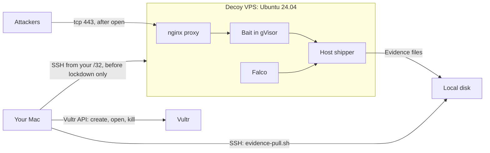

# Vultr Launch Guide

This guide covers the native Infrastructure bootstrap. A clean VPS has not run this exact release.
**Scripts:** `scripts/vultr-launch.sh` (Mac side) and `scripts/test-vultr-launch.sh` (offline test).

## What you launch

One disposable Ubuntu 24.04 VPS runs the bait service. The VPS holds no data of yours.
The Mac creates it through the Vultr API. The Mac then deploys to it with `scripts/deploy-ubuntu.sh`.

The deploy script installs Docker, gVisor, Falco, nftables rules, auditd and the systemd units.
It builds the bait image on the VPS. The VPS holds no Vultr key.

## Decisions to approve

`scripts/vultr-launch.sh plan` prints the current prices. Nothing is created until you approve each decision.

| # | Decision | Recommended | Other choices |
|---|---|---|---|
| 1 | Plan | `vc2-2c-4gb`: 2 vCPU, 4 GB RAM, 80 GB SSD, $20/month ($0.027/hour) | `vc2-1c-2gb` $10 (tight: Falco, Docker and gVisor share 2 GB); `vc2-2c-2gb` $15; `vhf-2c-4gb` $24 (NVMe). Do not use a 1 GB plan. |
| 2 | Region | `ewr` (New Jersey) | Any of the 33 Vultr regions that offer the plan |
| 3 | Public ports | `443` (default profile) | `443,80,8000,11434` (discovery profile); `none` (closed-ingress build) |
| 4 | Egress control | Accept that the host firewall is the only egress control (see below) | Use a provider with outbound firewall rules |
| 5 | Public listener | Build it first (see "Public listener") | Launch a closed-ingress build only |
| 6 | Vultr API key | A sub-user key with only provisioning and firewall permission | Keep the current key |
Billing is hourly. A powered-off instance still bills. `destroy --yes` stops billing.
The script creates no other billed resource. A forensic snapshot (`kill --snapshot`) bills separately.

## Run order

Before you deploy, confirm you have the reviewed release checkout and deployment approval.

1. `scripts/vultr-launch.sh plan`. Read the checks. Copy the `create` command that it prints.
2. `create --approve <token> --accept-host-only-egress`. The script creates an SSH key, a firewall group and the instance. The firewall allows SSH from your IPv4 /32 only. No public port is open. Wait 3 to 8 minutes.
3. Run `make release-check PLATFORM=linux/amd64` from the clean release checkout. After deployment approval, set `commit` to the full ID from the release record. Run `make deploy PLATFORM=linux/amd64 COMMIT="$commit" APPROVE="$commit"`.

   The launcher uploads an archive of that commit and stages a checksum-pinned OpenTelemetry Collector. It includes vendored Go dependencies when the module uses them. The VPS uses no network during the Go builds.

   The deploy script checks the systemd DNS stub before it switches the host resolver. The gVisor overlay gives the proxy a fixed private address for the bait. The host stores evidence on disk.

   If bootstrap fails after the final firewall is active, inspect the failed stage before a retry. The final firewall blocks new image downloads.

4. Check the evidence files. Use `scripts/evidence-pull.sh` from the Mac or the console `cmd/attackbox-live` with SSH. Wait for the shipper heartbeat. Check the six streams. Check that sandbox egress produces `egress` events. Use `scripts/vultr-launch.sh ssh '<command>'` to look at the VPS.
   For deployment without the Vultr launcher, run `go mod vendor` in the clean source tree before you transfer it to the VPS.
5. Open the Vultr web console for the instance. Make sure it loads.
6. `lockdown --console-confirmed`. The script checks that each approved port has a public listener. It then turns sshd off, deletes the SSH firewall rule and deletes the account SSH key. It removes the local keys.
7. Check evidence collection again. The VPS is now sealed.
8. `open --yes`. The script adds one inbound rule per approved port. Test from a separate host, not from the Mac.

Other commands: `status` (state, rules, 7-day bandwidth, billing), `kill [--snapshot]` (power off), `destroy --yes` (delete everything in the state file).
Rebuild every week and after every power-off alert: `destroy --yes`, then start at step 1.

## What the script does for safety

- **Approval token.** The token is a hash of plan, region, image, ports and price. A changed price or option invalidates it.
- **Key handling.** The Vultr key comes from the environment or `.env`. It goes to curl through a config file descriptor, never through argv. When the script reads the key from `.env`, it sets that file to mode 600. The script never prints the key or the instance root password.
- **Scope.** The script touches only the IDs in `.vultr/state.json`. The directory is mode 700 and git ignores it.
- **SSH window.** The firewall allows SSH from one IPv4 /32. The script pins an ed25519 host key that it injects with cloud-init. It uses `StrictHostKeyChecking=yes`, key login only, no agent forwarding and no `~/.ssh/config`.
- **Secrets.** The deploy bundle comes from git, so untracked files do not leave the Mac. The script refuses to deploy when a deploy file has uncommitted changes.
- **Lockdown.** The deploy script runs in a detached systemd unit, because stopping sshd can end the SSH session. The Mac then proves that port 22 is closed. The SSH rule and key stay in place until it is closed.
- **Port allowlist.** Only 80, 443, 8000 and 11434 can open.

## Limits you must know

1. **Vultr filters inbound traffic only.** Vultr documents that outbound traffic is not filtered by the Vultr Firewall. The plan requires provider outbound rules that root on the decoy cannot change. On Vultr, the host nftables policy is the only egress control. Host root can remove it.
   Compensation: weekly rebuild; evidence monitoring; `status` shows outbound bytes per day from Vultr. A large rise means a failed egress policy: run `kill`.
   `docs/operator.md` says the provider firewall limits outbound traffic. That statement is false on Vultr.
2. **Public listener.** `compose.yaml` publishes the proxy on `127.0.0.1:8443` and `127.0.0.1:8080` only. No public port reaches the bait today (`IMPROVE.md`, item I01). Today the build is closed-ingress. `lockdown` refuses while an approved port has no public listener. Use `VULTR_PORTS=none` to run a closed-ingress validation build.
3. **Vultr API key.** Use a key with only the permissions necessary for provisioning and firewall changes. Restrict access to your IP.
4. **Ubuntu security updates.** The deploy script replaces the default Vultr Ubuntu mirror with `archive.ubuntu.com`. The firewall permits root and `_apt` to reach the Ubuntu mirrors. At first bootstrap, the script refreshes Ubuntu indexes and runs unattended upgrades before it starts Attack Box. A failure stops bootstrap and leaves the update pending for the next run. Normal runtime access excludes third-party package repositories. Native provisioning opens fixed repository destinations through expiring install-only sets, then clears them. Native Infrastructure retains destination-scoped HTTPS access and periodic DNS refresh.
6. **Console recovery is not verified on a live instance.** Open the console and make sure that it accepts a login before SSH lockdown.

## Tests

The full local gate runs the launcher and native bootstrap tests. The launcher tests substitute local stubs for `curl`, `ssh`, and `nc`. They check the release guard, archive contents, key handling, and resource scope.

## Native host acceptance

Before public exposure, verify the host services on a fresh, closed-ingress VPS. Check the evidence files for the reporting host and its shipper heartbeat. A passing local release check does not prove on-host evidence collection.
