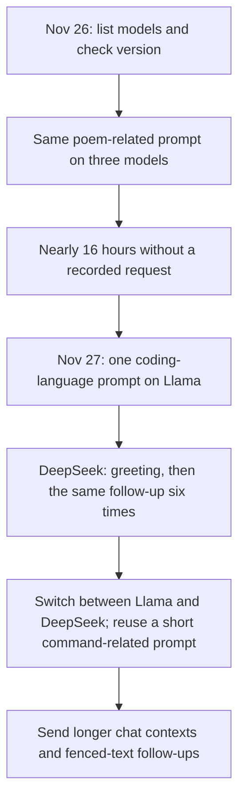

# One Ollama client: from a poem prompt to repeated chat turns

One TCP peer sent 43 requests to the simulated Ollama listener on port 11434 on November 26–27, 2026. Ten requests checked the model list or version. The other 33 carried prompts. Every request received HTTP 200. The public gateway did not run a model or execute a command.

## What the client sent

Each `P` number identifies one distinct prompt text, in order of first appearance. For generation, it represents the `prompt` field. For chat, it represents the **last user message**, not the system message or the entire conversation. Reusing an ID means the decoded text was identical, including case and whitespace. All 33 bodies parsed as JSON; none had the capture truncation flag. Times below are UTC and come from the host capture.

| Capture time | Model | Last user prompt in request order | Evidence |
|---|---|---|---|
| Nov 26 23:46:32–34 | Llama, DeepSeek, Qwen | P1 → P1 → P1 | The same 47-character prompt contained the word for a poem. Only the model changed among the three model selections. |
| Nov 27 15:40:08 | Llama | P2 | One 100-character message mentioned a programming language. No system message accompanied it. |
| 15:54:13–25 | DeepSeek | P3 → P4 × 6 | P3 was exactly `hi` (lowercase, no punctuation). P4 was the same 153-character command-related text each time. The supplied history grew from 4 to 14 messages across the six repeats. |
| 16:11:33–16:13:24 | Llama, then DeepSeek | P5 → P3 → P5 → P3 → P5 → P3 → P5 → P6 → P7 → P7 | P5 was a 27-character command-related message. P6 was five characters. P7 mentioned a task and a command and contained a code fence. |
| 16:17:13–16:17:36 | Llama | P5 → P3 → P8 → P9 | P8 was three characters. P9 was 222 characters and mentioned a command. Its request contained two consecutive user messages after a system message. |
| 16:22:59–16:24:08 | Llama | P5 → P9 → P10 → P11 → P12 | P11 was the longest final user message: 4,139 characters. P10 and P12 contained code fences and mentioned a command. |
| 16:24:29–37 | DeepSeek | P5 → P13 → P14 | P13 was 331 characters and mentioned a command. The 84-character P14 also contained a code fence. |

Model names in the capture: `llama3.3:70b`, `deepseek-r1:70b`, and `qwen2.5-coder:32b`. Qwen appeared only in the generation burst. The table omits the ten requests without prompts.

**Quoted wording:** Five requests had the exact final user message `hi` (P3). Wording is withheld for the other 13 distinct prompts across 28 requests. The descriptions in the table are not quotations.
The [publication-ready prompt file](https://github.com/caretak3r/attack-box/blob/main/findings/2026-11-27/cleared-prompts.json) lists the cleared wording and the five UTC timestamps.

## Host, headers, and query strings

All 43 request targets were origin-form paths with **no query string**. All used HTTP/1.1 and addressed the decoy by its IPv4 literal and port 11434 in `Host`, not by a product hostname. `Host` is the destination supplied by the client, not the source. The source is one anonymized TCP peer. No request had an `Authorization`, `X-API-Key`, or `Cookie` header.

The first six requests had `aiohttp` in the user-agent. The remaining 37 identified as Python Requests and added `Connection: keep-alive`. Both profiles sent `Accept: */*`, a `User-Agent`, and `Accept-Encoding` advertising gzip, deflate, and zstd. POSTs added `Content-Type: application/json` and `Content-Length`; GETs sent neither. These are client claims, not proof of the program or OS behind the address.

## Request ledger: all 43 requests

The capture time is UTC, to milliseconds. Every row received HTTP 200. For POSTs, `Bytes` is both the declared `Content-Length` and the retained JSON body length. GETs had no captured body. **S/U/A/T** counts system, user, assistant and tool messages in the submitted `messages` array. It is not a transcript of responses. A dash means not applicable.

| Nov UTC | Method and path | Bytes | Model | Final input (characters) | S/U/A/T | Body profile |
|---|---|---:|---|---|---|---|
| 26 23:46:31.526 | `GET /api/tags` | 0 | — | — | — | — |
| 26 23:46:31.633 | `GET /api/version` | 0 | — | — | — | — |
| 26 23:46:32.413 | `POST /api/generate` | 102 | Llama | P1 (47) | — | G |
| 26 23:46:33.996 | `POST /api/generate` | 105 | DeepSeek | P1 (47) | — | G |
| 26 23:46:34.603 | `POST /api/generate` | 107 | Qwen | P1 (47) | — | G |
| 27 15:40:08.980 | `POST /api/chat` | 222 | Llama | P2 (100) | 0/1/0/0 | C1 |
| 27 15:53:36.374 | `GET /api/tags` | 0 | — | — | — | — |
| 27 15:54:13.599 | `POST /api/chat` | 2,356 | DeepSeek | P3 (2) | 1/1/0/0 | C3 |
| 27 15:54:15.190 | `POST /api/chat` | 2,619 | DeepSeek | P4 (153) | 1/2/1/0 | C3 |
| 27 15:54:16.806 | `POST /api/chat` | 2,945 | DeepSeek | P4 (153) | 1/3/2/0 | C3 |
| 27 15:54:18.402 | `POST /api/chat` | 3,271 | DeepSeek | P4 (153) | 1/4/3/0 | C3 |
| 27 15:54:20.007 | `POST /api/chat` | 3,597 | DeepSeek | P4 (153) | 1/5/4/0 | C3 |
| 27 15:54:24.254 | `POST /api/chat` | 3,923 | DeepSeek | P4 (153) | 1/6/5/0 | C3 |
| 27 15:54:25.842 | `POST /api/chat` | 4,249 | DeepSeek | P4 (153) | 1/7/6/0 | C3 |
| 27 16:11:32.422 | `GET /api/tags` | 0 | — | — | — | — |
| 27 16:11:33.346 | `POST /api/chat` | 476 | Llama | P5 (27) | 0/1/0/0 | C4 |
| 27 16:11:43.757 | `POST /api/chat` | 571 | Llama | P3 (2) | 1/1/0/0 | C2 |
| 27 16:11:52.125 | `GET /api/tags` | 0 | — | — | — | — |
| 27 16:11:58.059 | `POST /api/chat` | 479 | DeepSeek | P5 (27) | 0/1/0/0 | C4 |
| 27 16:12:00.912 | `POST /api/chat` | 574 | DeepSeek | P3 (2) | 1/1/0/0 | C2 |
| 27 16:12:12.286 | `GET /api/tags` | 0 | — | — | — | — |
| 27 16:12:15.436 | `POST /api/chat` | 479 | DeepSeek | P5 (27) | 0/1/0/0 | C4 |
| 27 16:12:17.838 | `POST /api/chat` | 574 | DeepSeek | P3 (2) | 1/1/0/0 | C2 |
| 27 16:13:15.788 | `GET /api/tags` | 0 | — | — | — | — |
| 27 16:13:18.345 | `POST /api/chat` | 479 | DeepSeek | P5 (27) | 0/1/0/0 | C4 |
| 27 16:13:21.744 | `POST /api/chat` | 577 | DeepSeek | P6 (5) | 1/1/0/0 | C2 |
| 27 16:13:23.338 | `POST /api/chat` | 793 | DeepSeek | P7 (48) | 1/2/1/0 | C2 |
| 27 16:13:24.922 | `POST /api/chat` | 1,009 | DeepSeek | P7 (48) | 1/3/2/0 | C2 |
| 27 16:17:12.169 | `GET /api/tags` | 0 | — | — | — | — |
| 27 16:17:13.198 | `POST /api/chat` | 476 | Llama | P5 (27) | 0/1/0/0 | C4 |
| 27 16:17:16.453 | `POST /api/chat` | 571 | Llama | P3 (2) | 1/1/0/0 | C2 |
| 27 16:17:20.576 | `POST /api/chat` | 572 | Llama | P8 (3) | 1/1/0/0 | C2 |
| 27 16:17:36.175 | `POST /api/chat` | 880 | Llama | P9 (222) | 1/2/0/0 | C2 |
| 27 16:22:58.520 | `GET /api/tags` | 0 | — | — | — | — |
| 27 16:22:59.534 | `POST /api/chat` | 476 | Llama | P5 (27) | 0/1/0/0 | C4 |
| 27 16:23:07.948 | `POST /api/chat` | 2,699 | Llama | P9 (222) | 1/2/0/0 | C2 |
| 27 16:23:08.829 | `POST /api/chat` | 2,957 | Llama | P10 (85) | 1/3/1/0 | C2 |
| 27 16:24:07.759 | `POST /api/chat` | 6,796 | Llama | P11 (4,139) | 1/2/0/0 | C2 |
| 27 16:24:08.638 | `POST /api/chat` | 7,058 | Llama | P12 (89) | 1/3/1/0 | C2 |
| 27 16:24:26.879 | `GET /api/tags` | 0 | — | — | — | — |
| 27 16:24:29.861 | `POST /api/chat` | 479 | DeepSeek | P5 (27) | 0/1/0/0 | C4 |
| 27 16:24:36.334 | `POST /api/chat` | 2,813 | DeepSeek | P13 (331) | 1/2/0/0 | C2 |
| 27 16:24:37.899 | `POST /api/chat` | 3,070 | DeepSeek | P14 (84) | 1/3/1/0 | C2 |

**Body profiles.** G was a `model`, one `prompt`, and `stream: true`. Every C profile sent `model`, `messages`, `stream`, and `options`:

| Profile | Stream requested | Options sent | Tools in request |
|---|---|---|---|
| C1 | No | `temperature: 0.1` | No `tools` field |
| C2 | Yes | `num_ctx: 8192`, `temperature: 0.3` | No `tools` field |
| C3 | No | `num_ctx: 8192`, `temperature: 0.3` | One definition |
| C4 | No | `num_ctx: 512`, `num_predict: 80`, `temperature: 0` | One definition |

A client can submit a tool definition without calling a tool. The gateway did not execute one. Raw definitions, supplied histories, full user-agent strings, and the destination address are not part of the public record.

## Interpretation and limits

The first burst is consistent with comparing models on the same input. The later chat requests show repeated prompts and client-supplied history, not 30 unrelated questions. Neither a command reference nor a code fence proves that the client requested execution. An assistant-role message in a later request is text the client supplied, not independent evidence of what the gateway previously returned.

The host capture and 43 distinct New Relic request spans agree on the route totals and response statuses. Only the host capture supplies the request bodies. The capture does not contain response bodies. A shared TCP peer does not identify a person or establish a single continuous session.

## Private transcript

In the operator's loopback dashboard, filter by the source address and port 11434. Select a request time to open its body. For chat, inspect the full `messages` array to distinguish the current user text from prior turns and system instructions. This public report omits the source address and unreviewed prompt text. The original evidence is subject to the host's seven-day retention.
