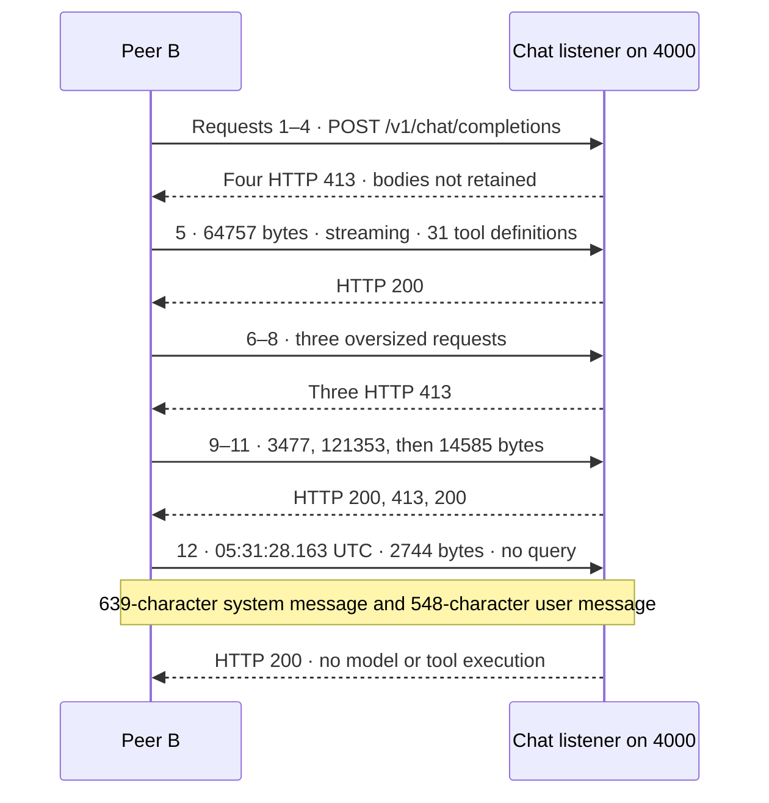

# Twelve chat requests on one port: which ones got through?

On November 28, one TCP peer made 12 requests to `POST /v1/chat/completions` on port 4000. The first four received HTTP 413 (content too large). The fifth received HTTP 200. The peer kept sending requests for another 28 minutes, with both outcomes on the same route.

| UTC, November 28 | What the gateway recorded |
|---|---|
| 05:00:37–05:01:49 | Four requests, four size rejections. |
| 05:03:37 | First HTTP 200. The body was 64,757 bytes: just 779 bytes below the limit. |
| 05:03:52–05:10:23 | Three size rejections on the same port and route. |
| 05:14:13–05:16:19 | A 3,477-byte request received HTTP 200. The next request received HTTP 413. |
| 05:29:42–05:31:28 | The last two requests received HTTP 200. Their bodies were 14,585 and 2,744 bytes. |

**What explained the split?** The gateway's body limit was 65,536 bytes. All eight rejected requests had reported sizes above that limit: 65,633 to 121,353 bytes. The smallest rejection was only 97 bytes over. Every request carried a recognized credential source, so credential presence alone did not distinguish success from rejection. No credential value was needed for this analysis.

The four accepted requests all named `local-instruct-8b`. Their final user messages were distinct: 5, 923, 9,451 and 548 characters, respectively. These are message lengths, not whole-request sizes. The first three messages remain withheld. Request 12 has a privately reviewed excerpt below. The host retained no request body for the eight size rejections.

## Host, target, and headers

All 12 requests used HTTP/1.1. The `Host` field named the decoy's IPv4 literal with port 4000. Each target was exactly `/v1/chat/completions`, with **no query string**. The same TCP peer sent all 12. A peer address cannot establish the identity of a person or machine behind it.

Every request advertised a Go HTTP client in `User-Agent` and sent `Content-Type: application/json`, `Content-Length`, `Accept-Encoding: gzip`, and `Authorization: Bearer [redacted]`. None sent `Cookie` or `X-API-Key`. The first header profile requested `Accept: text/event-stream` (SSE); the other requested `Accept: application/json` (JSON). The ledger identifies which appeared on each request. A header is not evidence about the format of a rejected body or the validity of a credential.

[Inspect all 12 requests on the site](https://silent.engineer/attack-box/findings/chat-body-limit/#request-details) · [Download the redacted request data](https://github.com/caretak3r/attack-box/blob/main/findings/2026-11-28/chat-body-limit.requests.json).

## Request ledger: all 12 requests

`Declared` is the request's `Content-Length`, in bytes. `Retained` counts body bytes in the host capture. A dash means the gateway rejected the request before capture; it does **not** mean the client sent an empty prompt. The final-user length counts characters, not bytes in the entire JSON request.

| UTC | Accept | Declared | Retained | HTTP | Body profile | Final user (characters) |
|---|---|---:|---:|---:|---|---:|
| 05:00:37.169 | SSE | 70,056 | — | 413 | not retained | — |
| 05:01:30.388 | SSE | 67,161 | — | 413 | not retained | — |
| 05:01:40.565 | SSE | 66,074 | — | 413 | not retained | — |
| 05:01:49.183 | SSE | 90,291 | — | 413 | not retained | — |
| 05:03:37.446 | SSE | 64,757 | 64,757 | 200 | streaming | 5 |
| 05:03:52.704 | SSE | 78,035 | — | 413 | not retained | — |
| 05:03:53.827 | SSE | 65,633 | — | 413 | not retained | — |
| 05:10:23.143 | SSE | 118,872 | — | 413 | not retained | — |
| 05:14:13.773 | JSON | 3,477 | 3,477 | 200 | non-streaming | 923 |
| 05:16:19.920 | SSE | 121,353 | — | 413 | not retained | — |
| 05:29:42.198 | JSON | 14,585 | 14,585 | 200 | non-streaming | 9,451 |
| 05:31:28.163 | JSON | 2,744 | 2,744 | 200 | non-streaming | 548 |

**What was inside the four retained bodies?** Each was a JSON object. All four had `model`, `messages`, `max_tokens`, and `stream`.

- **05:03:37:** `stream: true`, `max_tokens: 32768`, `stream_options`, and **31 tool definitions**. The message array contained one system message and three user messages; its final user text was only five characters. The 64,757 bytes describe the whole request, including definitions and earlier messages.
- **05:14:13, 05:29:42, and 05:31:28:** `stream: false`, `max_tokens: 1500`, and a `thinking` field. Each message array contained one system message and one user message. None supplied a `tools` field. The middle request had the longest final user message (9,451 characters), not the largest body.

**The 05:31:28.163 UTC request in detail:** `POST /v1/chat/completions HTTP/1.1`, no query. The 2,744-byte JSON body had `model: "local-instruct-8b"`, `max_tokens: 1500`, `stream: false`, and `thinking: {"type":"disabled"}`. `messages[0]` was a 639-character system message. `messages[1].content` was the 548-character user prompt. This request did **not** include the 31 tool definitions.

**What did the prompt say?** The client supplied Chinese notes organized as nodes to condense, a parent–child relation, and an earlier task objective. The objective was explicit:

> 目标：拿下后台权限 拿下服务器权限 获取数据 源码等 全量信息

English translation: “Objective: gain backend access, gain server access, and obtain all available information, including data and source code.” The same message said `但未形成管理或服务器执行链` (“but no chain to administrative access or server-side execution was established”). Both statements came from the client. They do not establish the status of any external system or show that the decoy was the intended target. [Open request 12 for its headers and reviewed prompt excerpt](https://silent.engineer/attack-box/findings/chat-body-limit/#request-12). Each `[redacted]` marks a removal; the excerpt omits target identifiers, a private file reference, and operational details.

No retained request included an assistant-role or tool-role message. The gateway did not execute these tools. No body fields, model name, or intent can be recovered for the eight rejected requests from the capture. Full user-agent strings, destination addresses, and unreviewed message text are not published.

## The 31 tool definitions

The 05:03:37.446 UTC request supplied these entries in this order. Each entry declared a function with an object parameter schema and a nonempty description. This is a **redacted schema inventory**, not a list of calls. An asterisk marks a required parameter; each `[redacted]` stands for one withheld identifier. Names and parameter types shown below matched fixed public vocabulary on the host. Descriptions, defaults, nested schemas and unreviewed identifiers are not reproduced.

| # | Function name | Top-level parameters (`name: type`, * = required) |
|---:|---|---|
| 1 | `[redacted]` | None |
| 2 | `[redacted]` | `[redacted]: array`, `evidence: string`, `[redacted]: integer`, `[redacted]: integer`, `name: string`, `[redacted]: string*`, `summary: string*`, `[redacted]: array`, `[redacted]: string*` |
| 3 | `record_fact` | `[redacted]: array`, `confidence: string`, `[redacted]: string`, `evidence: string`, `facts: array`, `[redacted]: array`, `[redacted]: integer`, `summary: string` |
| 4 | `[redacted]` | `[redacted]: array`, `confidence: string*`, `content: string*`, `evidence: string*`, `kind: string*`, `status: string`, `title: string*` |
| 5 | `[redacted]` | `[redacted]: array*` |
| 6 | `[redacted]` | `[redacted]: string`, `id: integer`, `[redacted]: array`, `limit: integer`, `offset: integer`, `type: string` |
| 7 | `[redacted]` | `limit: integer`, `[redacted]: string*` |
| 8 | `[redacted]` | `[redacted]: integer*`, `limit: integer`, `[redacted]: string`, `[redacted]: array` |
| 9 | `[redacted]` | `id: integer*` |
| 10 | `Read` | `file_path: string*`, `limit: integer`, `offset: integer` |
| 11 | `Write` | `content: string*`, `file_path: string*` |
| 12 | `Edit` | `file_path: string*`, `new_string: string*`, `old_string: string*`, `replace_all: boolean` |
| 13 | `LS` | `path: string` |
| 14 | `Bash` | `command: string*`, `run_in_background: boolean`, `timeout_ms: integer` |
| 15 | `sleep` | `seconds: integer*` |
| 16 | `Skill` | `args: string`, `name: string*` |
| 17 | `[redacted]` | `[redacted]: string`, `[redacted]: string*`, `[redacted]: integer`, `offset: integer`, `[redacted]: string` |
| 18 | `[redacted]` | `action: string*`, `[redacted]: string`, `[redacted]: array`, `[redacted]: boolean`, `[redacted]: string`, `[redacted]: string`, `target: string`, `type: string`, `url: string` |
| 19 | `shell_open` | `cols: integer`, `command: string*`, `mode: string`, `[redacted]: string`, `[redacted]: integer`, `rows: integer`, `[redacted]: integer`, `[redacted]: array` |
| 20 | `shell_send` | `[redacted]: array`, `keys: array`, `[redacted]: string`, `[redacted]: string`, `[redacted]: integer`, `session_id: string*`, `[redacted]: boolean`, `text: string`, `timeout_ms: integer`, `wait: boolean` |
| 21 | `shell_read` | `[redacted]: boolean`, `max_bytes: integer`, `max_lines: integer`, `session_id: string*`, `[redacted]: integer`, `[redacted]: string` |
| 22 | `shell_close` | `session_id: string*` |
| 23 | `shell_list` | None |
| 24 | `WebFetch` | `[redacted]: boolean`, `url: string*` |
| 25 | `TodoWrite` | `todos: array*` |
| 26 | `TaskOutput` | `block: boolean`, `max_bytes: integer`, `task_id: string*`, `timeout_ms: integer` |
| 27 | `TaskStop` | `task_id: string` |
| 28 | `TaskList` | None |
| 29 | `[redacted]` | `command: string*`, `description: string` |
| 30 | `[redacted]` | `query: string*` |
| 31 | `[redacted]` | `params: object`, `tool_name: string*` |

**Evidence and limits.** The host capture and 12 distinct New Relic request span IDs agree: eight HTTP 413s and four HTTP 200s. The review ends at 05:42:19 UTC. The size pattern explains what the gateway accepted. It does not establish deliberate limit testing, the peer's identity, or an exploit. HTTP 200 describes a synthetic service response, not model or tool execution. Exact response bodies were not recorded.
