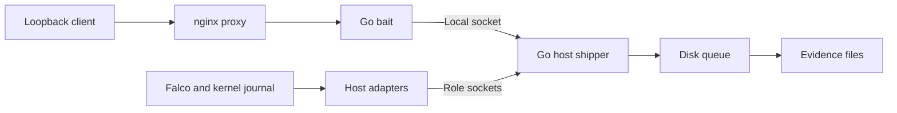
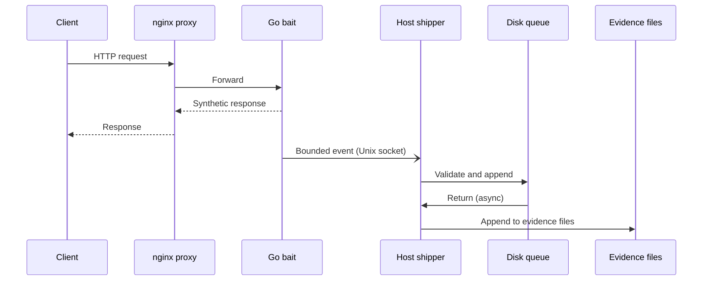

# Architecture

The Go bait process answers HTTP requests. A separate Go host shipper validates records and appends them to append-only evidence files on the host.

| Technology | Responsibility |
|---|---|
| Go | API simulation, record validation, and queue delivery. |
| nginx, Docker Compose, and gVisor | Local proxy and sandboxed containers in the Ubuntu deployment profile. |
| systemd and nftables | Host process management and network policy. |
| Falco and the kernel journal | Host runtime and egress observations. |
| Local evidence files | Append-only JSONL with rotation by date and size. |

## Request and response timing

The bait returns a response before the shipper acknowledges the record. Delivery runs independently of the HTTP transaction.

The sequence shows separate paths. A successful socket write does not prove disk commit or remote receipt.

## Trust boundaries

The bait container holds no ingest key in the supplied deployment. The shipper validates every record by role before queueing.

| Boundary | Control |
|---|---|
| Bait to shipper | One-way Unix socket. The bait sends records; the shipper never replies with data. |
| Role admission | The shipper admits only the streams and actions each role may send. The bait may send `edge`, `transcript`, `probe`, and `runtime` records. Host adapters may send `egress` and `runtime` records. |
| Structural validation | The shipper rejects malformed JSON, oversized payloads, and invalid field values before queueing. |
| Captured text | Request bodies, response text, and log messages are untrusted data. Redaction can miss secrets. Do not execute captured commands or open extracted links. |

## Containment layers

The Ubuntu deployment profile applies multiple containment controls. The table lists only controls that the deployment files confirm.

| Layer | Mechanism |
|---|---|
| gVisor runtime | Containers run under `runsc` with `--host-uds=open` to reach the shipper socket. |
| Non-root containers | The bait and proxy containers run as UID 65532. No process runs as root inside containers. |
| Read-only root filesystem | Both containers use `read_only: true`. Writable paths are bounded tmpfs mounts. |
| Loopback-only proxy | The nginx proxy publishes on `127.0.0.1` only. The internal network has `internal: true`. |
| nftables egress policy | Host nftables rules deny container egress. Dropped connections are logged to the kernel journal. |
| Falco sensor | The modern-BPF sensor records container process, file, and network activity. |
| Kernel audit | The audit subsystem logs container execve and connect syscalls. |

No capability grants, no privileged mode, and no Docker socket access.

## Public gateway

The public gateway is a second Go service in its own gVisor container. It does not use the bait, the shipper, or the disk queue. It exports spans and metrics through its own OpenTelemetry Collector on the host, and writes request captures to the host. Read [Public gateway](/public-gateway/) for the ports, the records, and the limits.

## Evidence files

The bait and shipper export OTLP traces and metrics over Unix sockets to local OpenTelemetry Collectors. The Collectors write to append-only JSONL files on the host.

Evidence locations: public requests in `/var/lib/attackbox-public-capture/requests/`, public spans in `/var/lib/attackbox-evidence/public-otel/`, private spans and metrics in `/var/lib/attackbox-evidence/otel/`, shipper events in `/var/lib/attackbox-evidence/shipper/`, audit-filter output in `/var/log/attackbox-audit/`, and Falco events in `/var/log/falco-events.jsonl`.

Files rotate by date and size. Retention is 7 days for public captures, 30 days and 8 GiB for shipper events, and 30 days with 60 backups for OTLP files.

Operators pull evidence with rsync over SSH into a local archive. The archive mirrors host paths and never deletes. Console tools work over one SSH session or against the local archive.

## Interpret telemetry

The six log streams are `edge`, `transcript`, `probe`, `runtime`, `egress`, and `heartbeat`. The streams do not form a complete wire transcript. Size limits, redaction, queue pressure, and failures can affect what arrives.

A successful socket write does not prove disk commit. A heartbeat shows that its reporting path worked at that time. Neither proves complete collection or containment.

For a controlled test with $N > 0$ synthetic requests, let $R$ count the requests with at least one matching edge record. Count matches per request, not per log row.

$$
\text{Observed match rate} = \frac{R}{N}
$$

This rate applies only to the test sample. It does not estimate loss for traffic with an unknown request count.

Treat captured payloads as untrusted. Redaction can miss secrets. Do not execute captured commands, open extracted links, or copy payloads into the documentation site.
