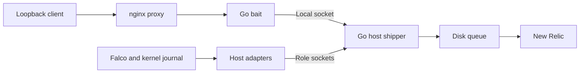

# Architecture

The Go bait process answers HTTP requests. A separate Go host shipper validates records and owns the remote ingest key in the supplied deployment.

| Technology | Responsibility |
|---|---|
| Go | API simulation, record validation, and queue delivery. |
| nginx, Docker Compose, and gVisor | Local proxy and sandboxed containers in the Ubuntu deployment profile. |
| systemd and nftables | Host process management and network policy. |
| Falco and the kernel journal | Host runtime and egress observations. |
| New Relic | Remote log and metric ingestion. |

## Interpret telemetry

The six log streams are `edge`, `transcript`, `probe`, `runtime`, `egress`, and `heartbeat`. The streams do not form a complete wire transcript. Size limits, redaction, queue pressure, and failures can affect what arrives.

A successful socket write does not prove disk commit. A heartbeat shows that its reporting path worked at that time. Neither proves complete collection or containment.

For a controlled test with $N > 0$ synthetic requests, let $R$ count the requests with at least one matching edge record. Count matches per request, not per log row.

$$
\text{Observed match rate} = \frac{R}{N}
$$

This rate applies only to the test sample. It does not estimate loss for traffic with an unknown request count.

Treat captured payloads as untrusted. Redaction can miss secrets. Do not execute captured commands, open extracted links, or copy payloads into the documentation site.
